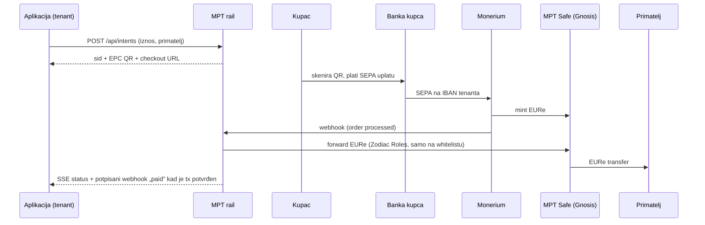
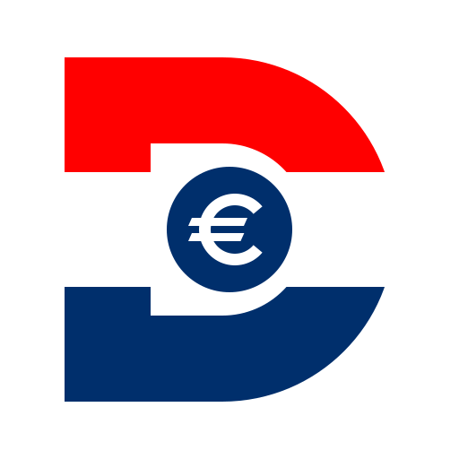

# pay.DOMOVINA.ai — MPT rail

[](https://github.com/domovinatv/pay.domovina.ai/actions/workflows/ci.yml)
[](./LICENSE)

<p align="center">
  <a href="https://pay.domovina.ai">
    
  </a>
</p>

**MPT (Mint Pay Transfer)** je most između SEPA plaćanja i eura na blockchainu. Kupac
plati običnom bankovnom uplatom (QR u Revolutu ili mobilnom bankarstvu), uplata se kroz
[Monerium](https://monerium.com) pretvori u **EURe** na Gnosis Chainu, a rail je
proslijedi primatelju i javi aplikaciji koja je naplatu tražila: webhookom, uživo preko
SSE-a i potvrdom o uplati koju svatko može provjeriti.

> **In English.** MPT turns a plain SEPA bank transfer into EURe (Monerium's regulated
> e-money token) on Gnosis Chain and forwards it to the payee. Apps create a *payment
> intent* over a small HTTP API, show the payer a QR, and get a signed webhook when the
> money settles on-chain. A self-serve sandbox needs no account:
> [developer quickstart](docs/integrations/sandbox-quickstart.md). The repo also holds a
> passkey-based self-custody wallet, a Shopify app and the original QR generator.

## Što je u repou

| Dio | Što radi | Gdje živi | Kod |
|---|---|---|---|
| **Rail (backend)** | Payment intents API, Monerium webhook, prosljeđivanje EURe s MPT Safea, više tenanata, uplate bez reference, potvrde o uplati, sandbox, admin | [mpt.domovina.ai](https://mpt.domovina.ai) (API, admin), `monerium.domovina.ai` (webhook) | [`backend/`](backend/) |
| **Wallet** | Self-custody EURe novčanik: passkey (Face ID) kao potpis, Safe smart account, slanje bez gasa, white-label brendovi, SDK za ugradnju u druge stranice | [wallet.domovina.ai](https://wallet.domovina.ai) | [`wallet/`](wallet/) |
| **Generator barkoda** | Iz jedne forme SEPA EPC QR, HUB3 PDF417 i EIP-681 QR; praćenje statusa uplate i POS prikaz | [pay.domovina.ai](https://pay.domovina.ai) | [`lib/`](lib/), [`web/`](web/) (Flutter) |
| **Shopify app** | Način plaćanja „SEPA → EURe” za Shopify trgovine: QR na stranici narudžbe, automatsko označavanje plaćenih narudžbi | nije još u produkciji | [`shopify/`](shopify/) |
| **On-chain** | Safe transakcije za postavljanje Zodiac Roles ovlasti, `PaymentRegistry` ugovor (nije deployan) | Gnosis Chain | [`backend/safe-tx/`](backend/safe-tx/), [`backend/contracts/`](backend/contracts/) |
| **Alati** | Postavljanje projekta (Safe + Monerium + kampanja), simulirana uplata, offline backup baze, javni checkpointi potvrda | lokalno | [`tools/`](tools/), [`scripts/`](scripts/) |

## Kako teče jedna uplata



Bitne osobine:

- **Plaćeno znači potvrđeno na lancu.** Webhook `paid` ide tek kad je prosljeđivanje
  potvrđeno na Gnosisu, ne kad je transakcija poslana.
- **Isplata samo na odobrene adrese.** Rail šalje novac jedino na adrese s whitelistom
  tenanta; adresa upisana u opis uplate ne može preusmjeriti novac
  ([ADR 0016](docs/decisions/0016-tenant-payout-whitelist.md)).
- **Svaki tenant ima svoj rail:** vlastiti Monerium račun, webhook i signer, tajne
  šifrirane u bazi ([ADR 0017](docs/decisions/0017-multi-tenant-rail.md)).
- **Uplate bez reference** se povezuju s intentom po tenantu, iznosu i vremenu; kad nije
  jednoznačno, admin dobije alarm i preusmjeri ručno
  ([ADR 0018](docs/decisions/0018-stray-payment-resolver.md)).
- **Potvrda o uplati** vezana je uz ključ uplatitelja. Potvrde se ulančavaju u dnevna
  sidra koja se upisuju u Bitcoin preko OpenTimestampsa, a provjeriti se mogu offline
  skriptom bez ovisnosti
  ([ADR 0022](docs/decisions/0022-potvrda-o-uplati-vezana-uz-kljuc-uplatitelja.md),
  [`scripts/mpt_receipt_verify.py`](scripts/mpt_receipt_verify.py)).

Stanja intenta i prosljeđivanja: [`docs/state-machines.md`](docs/state-machines.md).

## Za developere: integracija

Najbrži put je samoposlužni **sandbox**: jedan `curl` vrati `pk_test_`/`sk_test_`
ključeve, uplate se simuliraju i prolaze isti put kao prave (isti oblik intenta, isti
checkout, isti potpisani webhookovi). Bez računa, banke i Moneriuma.

→ **[Sandbox quickstart](docs/integrations/sandbox-quickstart.md)**

Glavne rute (baza `https://mpt.domovina.ai`):

| Ruta | Namjena |
|---|---|
| `POST /api/intents` | Novi payment intent (zadano 15 min, najviše 24 h; `return_url` samo uz `sk_` ključ) |
| `GET /api/intents/:sid` | Status intenta |
| `GET /api/intents/:sid/stream` | Status uživo (SSE) |
| `GET /api/intents`, `GET /api/intents/stats` | Lista i zbrojevi intenta za tenant ključa (`sk_`) |
| `GET /checkout/:sid` | Hostana stranica za plaćanje s QR-om i statusom |
| `POST /api/sandbox/tenants` | Novi sandbox tenant i ključevi |
| `GET /potvrda/:sid` | Potvrda o uplati (PDF u pregledniku) |
| `GET /api/receipts/anchors/latest` | Zadnje sidro potvrda |

Ključ se šalje u zaglavlju `x-mpt-key` ili kao `Authorization: Bearer`. Javni hostovi
pod `*.mpt.hr` s `/v1` putanjama su u planu; `mpt.domovina.ai` ostaje trajni alias
([ADR 0021](docs/decisions/0021-mpt-hr-javni-hostovi-i-api-v1.md)).

Ostale integracije: [Shopify / WooCommerce](docs/integrations/shopify-woocommerce-gateway.md),
[wallet SDK](wallet/) (`wallet.domovina.ai/sdk.js`, [ADR 0009](docs/decisions/0009-iframe-sdk-third-party-embedding.md)).

## Što je u produkciji, a što nije

**Radi u produkciji:** payment intents sa SSE-om, prosljeđivanje na potvrdu na lancu,
whitelist isplata, rail po tenantu, povezivanje uplata bez reference, potvrde o uplati sa
sidrima, samoposlužni sandbox, admin s prijavom preko Cloudflare Accessa i passkeya,
detektor neočekivanih odljeva sa Safea, wallet sa slanjem, više passkeyeva i SDK-om.

**U planu ili u izradi:**

- javni hostovi `api.mpt.hr` / `/v1` ([ADR 0021](docs/decisions/0021-mpt-hr-javni-hostovi-i-api-v1.md))
- potpisivanje prosljeđivanja izvan oblaka, M-od-N Android uređaja ([ADR 0019](docs/decisions/0019-off-cloud-forward-signer.md))
- dojava uplata na hrvatski IBAN bez minta ([ADR 0020](docs/decisions/0020-hr-iban-listener-bez-minta.md))
- sidro potvrda na Gnosisu (`MptReceiptAnchorV1`), Shopify app ([`shopify/`](shopify/)), `PaymentRegistry` ugovor, on-chain ograničenje primatelja u Zodiac Roles (`safe-tx/006`)
- on-chain atestacija telefona i eOI za wallet (ADR 0003–0006)

Sve odluke i njihov status: **[`docs/decisions/INDEX.md`](docs/decisions/INDEX.md)**.

## Arhitektura

| Sloj | Tehnologija |
|---|---|
| Rail | Cloudflare Workers (Hono), D1, KV, Durable Objects za SSE, cron svake 2 min i svakih 6 h |
| Wallet | Vite + React + TypeScript PWA, Cloudflare Pages + Pages Functions (relayer) |
| Generator | Flutter web (WASM) na Cloudflare Pages |
| Shopify | Checkout UI extension + Cloudflare Worker s D1 |
| Lanac | Gnosis Chain, Monerium EURe, Safe v1.4.1 + Zodiac Roles Modifier v2 |
| Banka | Enable Banking (čitanje izvoda za HR IBAN) |

### On-chain adrese (Gnosis, chainId 100)

| Što | Adresa |
|---|---|
| EURe (Monerium, V2) | [`0x420CA0f9B9b604cE0fd9C18EF134C705e5Fa3430`](https://gnosisscan.io/address/0x420CA0f9B9b604cE0fd9C18EF134C705e5Fa3430) |
| MPT Safe (2-od-3) | [`0x449aBCEf4e29a7Dd8d98dB451AF2c463561BAf2e`](https://gnosisscan.io/address/0x449aBCEf4e29a7Dd8d98dB451AF2c463561BAf2e) |
| Zodiac Roles Modifier | [`0x330347d656b1a5DF972f758DE1E25E99ec36762c`](https://gnosisscan.io/address/0x330347d656b1a5DF972f758DE1E25E99ec36762c) |

Novac na MPT Safeu mogu pomaknuti samo 2 od 3 vlasnika. Backend ima jedino ulogu
`EUReForwarder`, koja smije pozvati samo EURe `transfer`. Detalji:
[`backend/safe-tx/README.md`](backend/safe-tx/README.md).

## Lokalni razvoj

```bash
# Rail
cd backend && npm ci
npm run db:migrate:local
npx wrangler dev            # --remote za javni URL na koji Monerium može slati webhook
npm test                    # vitest

# Wallet
cd wallet && npm ci
npm run dev                 # Vite na :5173; brend bira VITE_BRAND (default, sportklub, zupa, edemokracija)

# Generator barkoda
flutter pub get
flutter run -d chrome
flutter test

# Shopify worker
cd shopify/worker && npm ci && npx vitest run
```

Svaki PR prolazi CI: `tsc` i `vitest` za backend, wallet i Shopify worker, dry-run
bundle Workera, produkcijski build walleta, `flutter analyze` i `flutter test`.

**Stari testovi su specifikacija.** CI na svakom PR-u pušta testove iz baze PR-a na novi
kod ([`scripts/compat-check.sh`](scripts/compat-check.sh)). Namjerna promjena ponašanja
nosi oznaku `behavior-change` i objašnjenje za svaki pokvareni test. Više u
[`docs/testing.md`](docs/testing.md).

## Deploy

```bash
cd backend && npm run db:migrate:prod && npx wrangler deploy     # rail
cd wallet && npm run ship:default                                 # wallet.domovina.ai
flutter build web --wasm --release && \
  npx wrangler pages deploy build/web --project-name=pay-domovina --branch=main   # generator
```

## Dokumentacija

| Mapa | Sadržaj |
|---|---|
| [`docs/decisions/`](docs/decisions/) | Arhitekturne odluke (ADR 0001–0024) s indeksom i statusom |
| [`docs/integrations/`](docs/integrations/) | Vodiči za integraciju: sandbox, Shopify/WooCommerce |
| [`docs/reference/`](docs/reference/) | Monerium ugovori, namira „plaćeno na potvrdu” |
| [`docs/runbook/`](docs/runbook/) | Operativni postupci: rotacija ključeva, detektor krađe |
| [`docs/postmortems/`](docs/postmortems/) | Što je pošlo krivo i što smo promijenili |
| [`docs/research/`](docs/research/) | Istraživanja: Aircash/HUB3, EURe prinos, wallet ekosustav |
| [`wallet/docs/`](wallet/docs/) | Wallet: passkey onboarding, relayer, staging |
| [`docs/process/`](docs/process/) | Kako je MPT građen uz Claude Code |

## Brand

<p align="center">
  
  &nbsp;&nbsp;
  
  &nbsp;&nbsp;
  
  &nbsp;&nbsp;
  
</p>

Platni sustav i srodni brendovi dijele jedan vizualni sustav: tamnoplava pločica
(`#002F6C`), bijeli geometrijski znak s ravno odrezanim krajevima i zlatni detalj
(`#E3AF35`) koji nosi značenje.

| Znak | Brend | Značenje |
|---|---|---|
| € | **pay.domovina.ai** (ovaj repo) | Bijeli kružni luk, zlatne paralelne crte koso odrezanih krajeva |
| M | **MPT** ([mpt.hr](https://mpt.hr)) | Srednji „V” je zlatni chevron prema dolje: uplata stiže trgovcu |
| K | **airKUNA** | Krakovi slova K su zlatni chevron |
| K u kovanici | **airKUNA token** | Isti K u kovanici sa zlatnim rubom |

Unutar obitelji proizvoda Domovina isti proizvod nosi logotip **Domovina Pay**: slovo
„D” s prugama hrvatske zastave i kovanicom s € u sredini
().

Kopije SVG-ova su u [`docs/brand/`](docs/brand/); izvor istine (SVG + PNG 2048 px) je
[mediakit](https://github.com/domovinatv/mediakit.domovina.tv).

## Licenca

Kod je pod **[MIT licencom](./LICENSE)** (© 2026 domovina.tv): slobodno koristite,
mijenjajte i forkajte uz vlastiti branding.

Brand resursi (logotip, ikona, paleta) nisu pod MIT-om; podliježu licenci
**[CC BY-ND 4.0](https://creativecommons.org/licenses/by-nd/4.0/)** iz
[mediakita](https://github.com/domovinatv/mediakit.domovina.tv).

Projekt vodi ITalk d.o.o. i dio je obitelji proizvoda **Domovina**.
