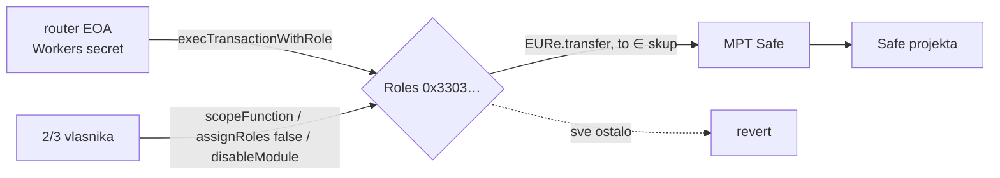

# Batch 009: rola `ProjectRouter` (ADR 0026)

> Pripremljeno, **nije izvršeno**. Potpisuju 2/3 vlasnika glavnog Safe-a. Odluka:
> [ADR 0026](../../docs/decisions/0026-project-router-ogranicen-na-projektne-safeove.md).

Rola smije samo `EURe.transfer(to, amount)` s glavnog Safe-a, gdje je `to` jedan od
projektnih Safe-ova iz skupa. Bez kapice na iznos, bez xDAI vrijednosti, bez DelegateCalla.
Rail njome prosljeđuje D4 uplate (opis izgubljen, mint na glavnom Safeu) na Safe projekta.



## Generator

```bash
cd backend/safe-tx
# prvi put (produkcija): modul + čišćenje stare role + scope + član
node 009-project-router-role.mjs --env gnosis --router 0x<novi router EOA> \
  --recipient 0x<Safe projekta> [--recipient …]

# novi projekt: postojeći skup se čita s lanca, dodaje se samo novi
node 009-project-router-role.mjs --env gnosis --recipient 0x<novi Safe>

# rotacija ključa
node 009-project-router-role.mjs --env gnosis --router 0x<novi> --revoke-router 0x<stari>

# Chiado (italk-sandbox): Roles proxy je zaseban po Safe-u
node 009-project-router-role.mjs --env chiado --roles 0x<proxy> --from-block <deploy blok> \
  --router 0x… --recipient 0x…
```

Generator pita lanac, ne repo:

- `owner()`, `avatar()`, `target()` modifiera moraju biti glavni Safe, a kod mora biti
  minimal proxy verificiranog mastercopyja `0x9646…D337`.
- Safe ne smije imati drugi modul (inače staje: istražiti).
- Trenutni skup je zadnji `ScopeFunction(ProjectRouter, EURe, transfer)`. Ako je nakon
  njega bio `AllowFunction`/`RevokeFunction`/`RevokeTarget`, ili stablo ima drugi oblik
  (npr. kapicu), generator staje.
- Stara rola `EUReForwarder` dobiva `revokeTarget` za svaki target koji joj je ostao živ
  (na produkciji samo EURe, jer `005` nikad nije izvršen).
- Koraci koji su već na lancu se preskaču. Ako se ništa ne mijenja, ne piše se datoteka.

## Simulacija na forku (obavezno prije potpisa)

```bash
node 009-simulate-fork.mjs --env gnosis --batch 009-project-router-role.gnosis.json
```

Pokrene `anvil --fork-url`, izvrši batch kao Safe i provjeri: router → svaki primatelj
prolazi (jedan stvarno izrudaren, saldo +1 wei); primatelj izvan skupa, sam glavni Safe,
xDAI vrijednost, DelegateCall, `approve`, drugi ugovor, ne-član i stari router kroz
`EUReForwarder` revertaju. Bez prolaznog transfera nema potpisa.

Prvi probni rad 16. 10. 2026. (blok 48776503, dva primatelja, router `0x…dEaD`): svih 13
provjera prolazi.

## Zašto je `Or` čvor `None`

Roles v2 `Integrity.sol` traži `paramType = None` za logičke čvorove (`And`/`Or`/`Nor`).
Batchevi 006 i 007 su ga slagali kao `Static`, pa bi `scopeFunction` revertao s
`UnsuitableParameterType(1)` (provjereno `eth_call`-om kao Safe). Ispravljeno je u oba, a
zajednički builder je `lib/roles-v2.mjs` (testovi: `test/safeTxRolesV2.test.ts`).

## Nakon izvršenja

1. Workers secret `PROJECT_ROUTER_PRIVATE_KEY` (ključ iz `000`, offline) i
   `PROJECT_ROUTER_ROLE_KEY = 0x50726f6a656374526f7574657200000000000000000000000000000000000000`
   u `wrangler.toml`.
2. Router EOA treba malo xDAI za plin (~0,1 xDAI je dovoljno za stotine prijenosa).
3. Zapisati `009-…EXECUTED.md` s tx hashem, po uzoru na `008`.
