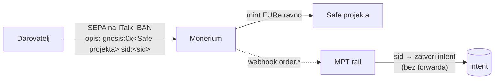

# Uplate po projektu: Safe + Monerium memo (sandbox stanje 11. 10. 2026.)

Cilj: svaki javni projekt s projekti.domovina.ai dobiva vlastiti Safe za donacije
(SEPA → EURe preko Monerium IBAN-a ITalka, ili izravno EURe), da se po saldu vidi
gdje se skuplja najviše novca. ITalk d.o.o. je vlasnik svih projekata, pa primanje
na ITalk profil nije „u ime trećeg" (Monerium ToS §16). Drugi ljudi isto rade kroz
vlastiti Monerium račun i vlastitog MPT tenanta.

Vezani dokumenti: [monerium-private.md](monerium-private.md) („Appovi, profili i MPT
tenanti", „Usmjeravanje po memu") · [ADR 0017](decisions/0017-multi-tenant-rail.md) ·
`energy.domovina.ai/docs/15` (ručni postupak za elektrane, ispravak 11. 10.)

## Odluka: opcija 2, izravni mint u Safe projekta



| | Opcija 1: forward kroz Roles | **Opcija 2: izravni mint** |
|---|---|---|
| Put novca | IBAN → glavni Safe → forward | IBAN → **Safe projekta** |
| Ručni korak po projektu | 2/3 tx: Safe na on-chain popis Roles | nema |
| Rail potpisuje | da (router EOA) | ne |
| Tko plaća prijenos | mi (plin) | Monerium |

Odbačena opcija 1 zbog ručnog 2/3 potpisa za svaki novi projekt (ADR 0017 drži
on-chain popis primatelja) i zato što rail tada drži ključ koji miče novac.

Dokaz da opcija 2 radi: produkcija, 1 € iz Revoluta, opis
`gnosis:0x4f7f…d0173 sid:test1` → 1 EURe na Lukavec Safe (15,34 → 16,34), rail
Safe 0. Pravilo i tablica oblika: monerium-private.md „Usmjeravanje po memu".

## Automatizacija: `tools/funding`

```bash
cd tools/funding && npm install
node funding-init.mjs --env sandbox --project <id> --title "<naziv>"
node check-balances.mjs --env sandbox --main <glavni Safe>
```

`funding-init` (idempotentan): Safe `project:<id>` → provjera vlasnika/praga/ERC-1271 →
Monerium `POST /addresses` → `projects.<env>.json` → ispiše dvije naredbe za konzolu
preglednika (ime adrese u Moneriumu, kampanja na MPT railu), jer oba API-ja traže
web sesiju.

Ključni trik: Safe se rodi s potpisanom Monerium porukom. `setup()` delegatecall na
SignMessageLib upiše `signedMessages[hash]`, pa `isValidSignature(hash, "0x")` vrati
`0x1626ba7e` i Monerium link prolazi s potpisom `"0x"` (201 linked) bez ijednog
potpisa vlasnika. Provjereno na sandboxu.

Zamke:
- **Chiado ima samo Safe 1.3.0** (1.4.1 i 1.5.0 nisu deployani). Gnosis prod: energy
  Safeovi su 1.5.0, rail Safe 1.4.1. Skripta bira verziju po okruženju.
- Adresa vlasnika `0xF3c4…6FB8` ima nestandardan checksum; viem je odbija, pa se
  vlasnici šalju malim slovima.
- Ime adrese u Moneriumu nije u javnom API-ju (v2 nema polje; `PATCH /api/addresses/:a/config`
  samo pod web sesijom, token appa dobiva 401).
- Sandbox „Simulate bank transfer" šalje nasumičan memo; vlastiti memo ide preko
  `POST /api/treasury/fund` iz konzole na sandbox.monerium.dev.
- Faucet za Chiado (gnosisfaucet.com) traži captchu, e-mail i potpis; klik na
  karticu CHIADO jednom je preusmjerio na lažnu captchu na `*.s3.filebase.io`.
  Otvarati izravno `https://faucet.gnosischain.com/?chain=chiado`.

## Stanje sandboxa (Monerium sandbox + Chiado)

| Što | Vrijednost |
|---|---|
| Monerium račun | sandbox, profil `22ac32be-3573-11f1-a66a-a6312d42aaad`, app `italk_domovina_projekti_sandbox` |
| Vjerodajnice + deployer ključ | `tools/funding/.env.sandbox` (gitignored, chmod 600) |
| Deployer EOA | `0x99150f78B30875323559B2C9aE232b5AB6464c65` (~0.04 xDAI) |
| MPT tenant | `italk-sandbox`, status **onboarding** |
| Glavni Safe (IBAN `EE51 4996 0969 7740 7661`) | `0xe2e21755d3F576F090Ecda1D830F3fDA865f37fF` (`italk-sandbox:main:v2`) |
| Router EOA (nepotreban za opciju 2) | `0x2964eEb493a386eC9A249570da3a70527a74D26B` (0.06 xDAI) |
| Webhook | `/api/monerium/webhook/t/italk-sandbox`, pretplata `ce5223ef-…` |
| Projekt Karta Hrvatske | `0xb3438D62c7B968806a7E3D78fc4b31Ee8F738720`, kampanja `domovinatv-karta-hrvatske` |
| Testni Safe | `0xfD07de234B8b1EE2a3Dca787Fc87232ce21471C2` (`project:test-link-1`) |
| Napušteni Safe | `0x93BFfFB0D6a255feC3256F7f4743fef4df344D6b` (bez potpisane poruke, prazan) |

`verify` za `italk-sandbox`: prolaze profil, IBAN, Safe, plin, webhook, whitelista;
ne prolaze Roles, role key, kapica (opcija 2 ih ne treba, vidi otvorene stavke).

Usput: prihvatni Safe tenanta `crosulja-staging` (`0xc857…`) na Chiadu **nema koda**.

## Otvorene stavke

1. Rail u načinu „direct": intent vraća `gnosis:0x<safe> sid:<sid>` (EPC i checkout);
   intent se zatvara kad je `order.address` cilj intenta, bez forwarda i bez alarma
   `mint_address_mismatch`; `verify`/`activate` za takvog tenanta ne traže Roles.
2. Checkout: gumb „kopiraj referencu" + uputa za Revolut (nakon skeniranja QR-a
   ostavlja Reference prazno).
3. PBZ je instant uplatu na EE IBAN odbio (ref. `20261011001286300522`, opis netaknut,
   razlog nepoznat). Svih 78 dosadašnjih dolaznih uplata je iz Revoluta (LT). Ponoviti
   kao običnu SEPA s adresom primatelja ili pitati PBZ.
4. Prod: `funding-init --env prod` za projekte (Safe 1.5.0, SignMessageLib adresa za
   1.5.0 još nije upisana u `lib.mjs`), deployer s xDAI na Gnosisu.
5. Katalog: polje `funding` na kartici (`realtime-presentation`), gumb „Podrži".
