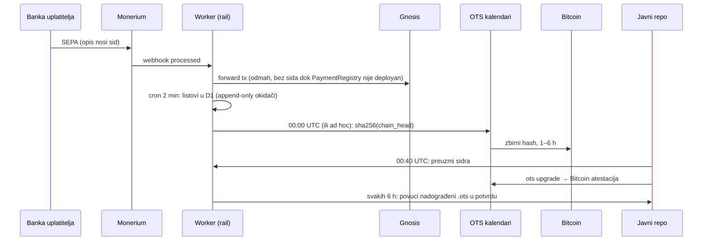

# Potvrde o uplati: dnevnik izvedbe 12. 10. 2026.

Jedan dan, od pitanja do prvog sidra u produkciji. Odluke su u
[ADR 0022](decisions/0022-potvrda-o-uplati-vezana-uz-kljuc-uplatitelja.md) i
[ADR 0023](decisions/0023-potvrde-nadogradnja-iz-maksimir-glasanja.md). Ovdje su mjerenja,
zamke i ono što se ne vidi iz koda.

## Što je u produkciji

| PR | Worker | Što |
|---|---|---|
| #91 | `660ceae6` | `r1` sid, `kind rcpt1`, izravni + naknadni listovi, dnevni Merkle + OTS, stranice `/potvrda` |
| #92 | `245aadff` | ulančana sidra (`chain_head`), okidači append-only, verifikator, javni repo; **FIX izvođenja sida** |
| #93 | `f9090c8b` | Bitcoin vrijeme u verifikatoru, `.ots` u potvrdi, pull nadograđenog `.ots`, Software Heritage |
| #94 | `512eaecc` | `target_address` / `tenant_id` po uplati; batch upis listova, dokazi po sidru |
| #95 | `5cd6cac1` | PDF u pregledniku, offline, bez dijaloga za ispis |
| #96 | `d83ccce3` | ad-hoc sidro `POST /api/receipts/anchors/now` (secret `RECEIPT_ANCHOR_KEY`) |

Frontend za uplatitelje je u `energy.domovina.ai` (`docs/16-potvrda-o-uplati.md`, `/beta/potvrda/`,
`/beta/provjera/`).

## Mjerenja

- **Uplate bez opisa:** 9 od 98 issue ordera u povijesti. Revolut ekran „spremno za isplatu"
  (stanje pokriva iznos) šalje nalog bez opisa: dvije testne uplate od 1 € stigle su s `memo ""`
  i `reference_number NULL`. Treća, s ručno zalijepljenom referencom, prošla je (Revolut
  `?sid=` → `?sid.`, parser to prihvaća).
- **Naknadno pokrivanje u praksi:** prva izravna potvrda s Matijinog IBAN-a pokrila je 73 ranije
  uplate prema desetak Safeova (puni backfill, Matijina odluka). Sidro #1: 74 lista, 79,93 €.
- **Sidro #1** (ad hoc, 09:24 UTC): `chain_head 0xfb79b98d6c72da4c479712c9aae6fdcc3d59c15ee3096e9c95485032fef7736d`,
  sva 4 OTS kalendara odgovorila, zrcaljeno u `domovinatv/mpt-receipts-checkpoints`.
- **PDF:** potvrda s 41 retkom = 371 KB, 3 stranice, 0,26 s u headless Chromiumu s isključenom
  mrežom. Worker je narastao s 0,77 na 1,7 MB gzip (pdf-lib + fontkit + Inter).

## Zamke

1. **`viem.concat` s mješavinom `Uint8Array` i hex stringova** kopira string znak po znak, pa
   slova a–f postaju 0. Prvi deploy (#91) je zato slabo vezao sid uz vlasnika (90 bajtova
   umjesto 50). Našao ga je stdlib Python verifikator jer je dao drugi sid. U produkciji tada
   nije bilo nijednog `r1` intenta. Zlatni vektor: `r183ns4pcpn659hd2z3xtaqiwq`.
2. **pdf-lib `subset: true` izbaci većinu glifova Intera.** Tekstualni sloj ostaje ispravan, pa ga
   testovi čitanja teksta ne vide; vidi se samo vizualno (render u PNG). Rješenje: `subset: false`.
3. **Ugrađeni Courier je WinAnsi**: `č` ruši PDF. JSON u PDF-u ide s `\uXXXX` escapeom.
4. **`compat-check.sh` ne vidi nepraćene fajlove** (prenosi samo `git diff`), pa novi moduli
   padaju na učitavanju dok nisu commitani. U novom worktreeu treba i `wallet/node_modules`
   (symlink iz glavnog checkouta).
5. **D1 enforca strane ključeve**: prepravak `receipt_anchors` (0028) tražio je i ponovno stvaranje
   `receipt_leaves` (referenca na stari stupac → „foreign key mismatch").

## Odbačeno

- **Jedinstveni iznos po intentu** (1,03 € umjesto 1,00 €) za vezanje uplata bez reference:
  Matija, „to je hack". Ne predlagati ponovno.
- **Zaštita javnog repoa od admina**: ne treba. Izvor istine je Bitcoin, a svaki klon, fork i
  potvrda je neovisan svjedok.

## Kada se što piše i koliko je dugo nesigurno

- **Nesigurni prozor:** od nastanka lista do OTS žiga do 24 h, pa do Bitcoin bloka još 1–6 h.
  Okidači odbijaju brisanje i prepisivanje. Admin D1-a mogao bi okidače maknuti, ali to bi se
  vidjelo u tekućim zbrojevima sljedećeg sidra.
- **Single points of failure** (stanje nakon #96):
  - Monerium je jedini izvor IBAN-a uplatitelja, a time i naknadnih veza;
  - jedan Gnosis RPC za potvrde forwarda;
  - ključ potvrde u jednom `localStorage` (ADR 0023 faza 4);
  - sidro još nije na Gnosisu (ADR 0023 faza 5).

  Dokazi više ne ovise samo o D1: postoje kopije u javnom repou, u Software Heritage i u svakoj
  potvrdi.

## Otvoreno

- Bitcoin atestacija sidra #1: lokalni proces `~/.config/mpt/ots-wait-trigger.sh` (dnevnik
  `~/.config/mpt/ots-wait.log`) pokreće Action čim stigne. Zatim treba provjeriti
  `--btc-api` verifikatorom i `ots_bitcoin: true` u potvrdi nakon sljedećeg 6-satnog ticka.
- ADR 0023 faza 4 (24 riječi + passkey PRF) i faza 5 (`MptReceiptAnchorV1` na Gnosisu).
- `PAYMENT_REGISTRY_ADDRESS` prazan: `kind rcpt1` nije na lancu.
- Mod 2 / način `direct`: povezivanje traži referencu `mpt:`/`cmp:` i forward kroz rail.
- Kopije formula (sid, list, `chain_head`) su i u energyju (`lib/receipt-sid.ts`,
  `/beta/provjera/`): svaku promjenu javiti tamo.
