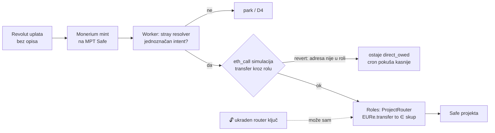

# Router ograničen na projektne Safe-ove (dogovoreni smjer za ADR 0026)

Dogovoreno s Matijom 16. 10. 2026. Ovo je ulaz za ADR 0026 i implementaciju. Odluka je
zapisana u [ADR 0026](decisions/0026-project-router-ogranicen-na-projektne-safeove.md).

Vezani dokumenti: [ADR 0025](decisions/0025-mpt-router-umirovljen-svi-tenanti-direct.md)
(§Revolut bez reference) · [postmortem 0002](postmortems/0002-admin-auth-bypass-percent-encoded-path.md)
· [`safe-tx/006`](../backend/safe-tx/006-scope-eure-transfer-recipients.md) ·
[uplate po projektu](2026-10-11-funding-po-projektu.md)

## Problem

ADR 0025 je skinuo router: MPT Safe nema modul, `ROUTER_PRIVATE_KEY` je obrisan. Revolut
nakon skeniranja QR-a briše opis plaćanja (svih 5 zadnjih uplata, 15.10.), pa Monerium
minta na MPT Safe i uplata postaje D4 `direct_owed`. Za premještanje treba ručni 2/3
prijenos. Odbijeno je i ostavljanje toga kao trajnog stanja i „Move IBAN" na Safe projekta
(ADR 0025, §Odbijeno).

## Zaključak: sigurnost je u ograničenju na lancu, ne u mjestu ključa

Router na Android telefonu u fizičkom posjedu **sam po sebi ne rješava problem**:

- Uz neograničenu rolu ukraden ili rootan telefon prazni Safe jednako kao ukraden
  Workers secret.
- Telefon mora znati *kamo* poslati novac. Ako to pita Worker, kompromitirani Worker ga
  navodi. Da ne pita, trebao bi vlastiti pristup Moneriumu i vlastitu kopiju intenata,
  tj. cijeli rail na telefonu.
- Dok je telefon ugašen ili bez mreže, uplate čekaju. To je opet ručno kašnjenje.

Android ostaje moguća **kasnija** nadogradnja. Štitio bi od krivog rutiranja među
vlastitim projektima, ali krađu već zaustavlja ograničenje na lancu.

## Dizajn

- **Rola `ProjectRouter`** na MPT Safe-u (Roles modul ponovno uključen, novi member EOA):
  jedino dopuštenje je `EURe.transfer(to, amount)`, gdje je `to` uvjet
  `Or(EqualTo(projekt₁), …, EqualTo(projektₙ))`, a `amount` je `Pass`.
  **Bez kapice na iznos** (Matija, ADR 0019 §Odbijeno). Samo `Send`: bez DelegateCalla,
  bez MultiSenda i PaymentRegistryja (to je zaobilaznica iz `006` §1).
- **Najgori slučaj, čak i uz potpuno kompromitiran Cloudflare:** novac s glavnog Safe-a
  ode u *krivi od vlastitih* projektnih Safe-ova. Detektor odljeva to vidi, a 2/3 vlasnika
  ispravi. Na lancu ne postoji put prema adresi izvan skupa.
- **Zašto je ovo sada moguće, a u `006` nije bilo:** popis primatelja tada je odbijen zbog
  51 walleta korisnika koji rastu (`wallet_registry`). Od ADR 0025 `italk` intent smije
  ciljati samo Safe kampanje (`findCampaignBySafe`), pa je skup mali i stabilan, a to je
  uvjet koji je `006` sam postavio.

## Novi projekt: jedan prijedlog u redu Safe-a, bez Transaction Buildera

`tools/funding/funding-init.mjs` već napravi Safe projekta, provjeri vlasnike i ERC-1271
te poveže adresu s Moneriumom (`POST /addresses`). Dodaje se korak:

1. Pročitaj s lanca trenutni skup primatelja role. Izvor istine je lanac, ne repo ni D1.
2. Složi `scopeFunction(ProjectRouter, EURe, transfer, <stari skup + novi>)`.
   **`scopeFunction` prepisuje cijelo stablo**, pa popis mora biti potpun.
3. Predloži transakciju u red MPT Safe-a preko Safe Transaction Servicea, potpisano
   ključem **delegatea**. Delegate može predložiti, ali ne potpisati ni izvršiti, pa
   njegov ključ ne nosi rizik. Jednokratno ga registrira jedan vlasnik.
4. Vlasnici potvrde u app.safe.global ili Safe mobilnoj aplikaciji („Needs confirmation").
   Pri potvrdi treba u dekodiranom prikazu provjeriti da su stari projekti još na popisu.

Ručno ostaje samo ime adrese u Moneriumu (API ga nema, `funding-init` ispiše naredbu za
konzolu).

## Router u kodu

- `direct_owed` s jednoznačnim intentom → forward preko `ProjectRouter`, ali tek nakon
  `eth_call` simulacije. Revert (adresa još nije u roli) znači da red ostaje
  `direct_owed`, a cron pokuša ponovno, pa se nakon potvrde 2/3 prijedloga uplata
  proslijedi sama.
- Novi router ključ (stari EOA `0xd612…54CB` je bez role; ostatak ~0,60 xDAI).
- Rail koji nema rolu `ProjectRouter` ponaša se kao danas (D4 + Telegram).

## Redoslijed

1. ADR 0026 (Proposed → Accepted), ovaj dokument kao izvor.
2. `safe-tx/009` generator: Roles v2 enumi (`ParameterType`, `Operator`,
   `ExecutionOptions`) **provjereni na deployanom ugovoru** prije potpisa (`006`
   §Verifikacija), test na forku ili Chiadu.
3. Chiado (`italk-sandbox`, Safe 1.3.0) od kraja do kraja: rola, delegate prijedlog,
   simulirana uplata bez opisa → auto forward.
4. Produkcija: novi router ključ kao Workers secret, batch 009 2/3, `funding-init`
   korak s delegateom.

## Otvoreno

- Gdje živi ključ delegatea (lokalno kod Matije uz `funding-init` ili u Workeru za
  budući admin gumb „Novi projekt").
- Per-tenant: svaki tenant s vlastitim glavnim Safe-om treba svoju rolu. Za sada samo
  `italk`.
- Gornja granica veličine `Or` stabla u Roles v2. Ako projekata bude puno: custom
  condition s registry ugovorom kojim upravlja 2/3.

Nastavak (produkcija, 2026-10-19): [ITalk u D1 rail + ProjectRouter](2026-10-19-italk-d1-rail-prelazak.md).
