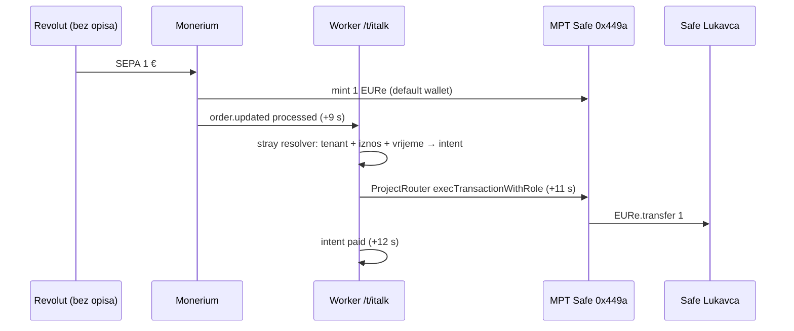

# ITalk u D1 rail + ProjectRouter na produkciji (2026-10-19)

PR [#130](https://github.com/domovinatv/pay.domovina.ai/pull/130) (priprema, `rail/import-env`) i
[#131](https://github.com/domovinatv/pay.domovina.ai/pull/131) (legacy env rail obrisan, migracija 0030).
Od tada je `italk` običan redak u `tenant_rail`; nema `isLegacyTenant` / `legacyRail`.

## Stanje nakon prelaska

| | |
|---|---|
| Rail | `tenant_rail.italk`: production, gnosis, `mode=direct`, Safe `0x449a…af2e`, Roles `0x3303…762c`, rola ProjectRouter |
| Webhook | `https://mpt.domovina.ai/api/monerium/webhook/t/italk`, pretplata `691668ab-…` (stara `937127a1-…` na `monerium.domovina.ai/api/monerium/webhook` ugašena) |
| Router | `0x79de1176b0A238aE05094735e50dE9eC1FF3Da77`, ključ generirao backend (`router_key_enc`), 0,1 xDAI |
| Rola | 2/3 potpisali batch iz setup dAppa (enableModule, revokeTarget EUReForwarder, scopeTarget, scopeFunction za Lukavec/Donja Lomnica/Rab, assignRoles) |
| D4 dugovi | `#187` tx `0x0997ddd8…`, `#198` tx `0x399a39b4…`, oba `confirmed` |

## Test bez reference (Revolut ispušta referencu iz QR-a)

Intent `r19pffbzuky99x723iwrrzjwup`, order `6ee0bfd4-…` s `memo: ""`:

## Redoslijed prelaska (ako se ikad ponavlja za drugi env tenant)

1. Na kodu s `import-env`: `suspend` → `rail/import-env` → `rail/router-key`.
2. `wrangler d1 migrations apply` (0030: `tenant_id NULL → italk`, `roles_from_block`).
3. Deploy koda bez legacy raila → `rail/webhook` → `rail/verify` → `resume`.
4. Setup dApp: 2/3 potpis s routerom iz retka. **Prvo xDAI na router, pa potpis.**

## Zamke koje su koštale vremena

- **Monerium `GET /webhooks` vraća `{subscriptions: [...], total}`**, ne golo polje.
  `MoneriumClient.listWebhookSubscriptions` je tipiziran kao polje, pa je `import-env` tiho vratio
  `legacy_subscription: null`. ID stare pretplate upisan ručno u `tenant_rail.webhook_subscription_id`
  prije `rail/webhook`, koji je onda sam ugasi (MT-05). Tip u klijentu je i dalje kriv.
- **Router bez plina u trenutku potpisa role**: cron je unutar 2 min simulirao (eth_call prolazi bez
  salda) pa broadcastao → `gas required exceeds allowance (0)` → redak `failed`, a cron vraća samo
  `owed`. Nonce routera je bio 0 (ništa nije otišlo), pa su `#187`/`#198` vraćeni u
  `pending` + `direct_owed` (audit `forward.reset_owed`). Rail bi mogao prije broadcasta provjeriti
  saldo i ostaviti redak `owed`.
- **Istekli intent ostaje `expired`** kad ga resolver veže i ProjectRouter isplati (`r1u9xcb2…`,
  forward `#187` `confirmed`). Novac je na pravom mjestu, prikaz nije.
- Revolut opet ispušta opis iz QR-a (orderi `5ae90d3c-…`, `6ee0bfd4-…` s `memo: ""`).

## Otvoreno

- Frontend energy.domovina.ai: saldo Lukavca skače 29 → 31 → 30 tijekom uplate bez reference
  (uplata vjerojatno brojena i kao „čeka" i kao saldo dok intent nije `paid`).
- Obrisati Workers secrete `MONERIUM_CLIENT_ID`, `MONERIUM_CLIENT_SECRET`, `MONERIUM_WEBHOOK_SECRET`
  nakon par dana (`INTENT_WEBHOOK_*` i `SAFE_ADDRESS` još čita onchain indexer).
- `listWebhookSubscriptions` tip, pre-broadcast provjera salda, `expired` → `paid` nakon owed isplate.

Vezani dokumenti: [ADR 0026](decisions/0026-project-router-ogranicen-na-projektne-safeove.md),
[2026-10-16 router ograničen na projekte](2026-10-16-router-ogranicen-na-projekte.md),
[safe-tx/009](../backend/safe-tx/009-project-router-role.md).
