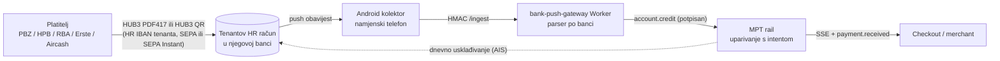

# ADR 0020 — MPT kao „payment listener“ za hrvatski IBAN: HUB3 + bank-push-gateway, bez minta

- **Status:** Proposed (2026-10-11)
- **Kontekst:** MPT rail (`backend/`), [bank-push-gateway](https://github.com/domovinatv/bank-push-gateway)
  (`/Users/ms/git/domovinatv/bank-push-gateway`, Android kolektor + CF Worker), checkout i klijenti
  (energy.domovina.ai, pay.domovina.ai)
- **Gradi na:** [0017](0017-multi-tenant-rail.md) (rail po tenantu) ·
  [0018](0018-stray-payment-resolver.md) (uparivanje po iznosu i vremenu) ·
  `docs/research/aircash/` (HUB3 format, test na uređajima) ·
  `docs/research/2026-09-monerium-first-iban-screening.md` (merchant-direct model)

## Problem

Monerium rail radi s Revolutom (EPC QR → SEPA → `EE…` IBAN → mint EURe → forward). Hrvatske
bankovne aplikacije i Aircash na tom railu **ne rade**. Test 2026-10-11 je pokazao sljedeće
(`docs/research/aircash/05-hub3-format-provjera.md`):

| Kod | PBZ iOS | HPB biz | RBA biz | Aircash |
|---|---|---|---|---|
| HUB3 PDF417 s Monerium `EE…` IBAN-om | čita, ne pušta | čita, ne pušta | čita, ne pušta | čita, „Unknown code“ |
| HUB3 PDF417 s **HR** IBAN-om | radi | radi | radi | radi |

HUB3 uplatnica je u praksi domaći nalog, vezan uz hrvatski IBAN primatelja. Upravo tako većina
građana plaća režije, a Aircash i bankovne aplikacije to rade bez naknade. Uz to:

- nijedna hrvatska banka pravnoj osobi ne daje webhook za dolazne uplate;
- PSD2 AIS (Enable Banking, GoCardless, `backend/src/providers/`) smije čitati račun ~4× dnevno,
  što znači kašnjenje od nekoliko sati;
- bankovne aplikacije o priljevu šalju push u roku od nekoliko sekundi.

bank-push-gateway taj push pretvara u potpisani webhook `account.credit`. Kolektor i Worker su
u produkciji, u fazi 0 („samo bilježi“, PBZ i HPB).

## Odluka (prijedlog)

Uvodi se **drugi način namire intenta**: novac ide izravno na **tenantov hrvatski račun** u
njegovoj banci. MPT ga ne drži, ne minta i ne prosljeđuje. MPT samo javlja da je uplata stigla
i uparuje je s intentom, kao Stripe-ova obavijest o statusu.

1. **Način namire po tenantu (i po intentu):** `monerium_mint` (današnji rail, `EE…`) ili
   `hr_iban_notify` (novo). Tenant za `hr_iban_notify` ima svoj HR IBAN, ime vlasnika računa i
   oznaku računa u gatewayu (`account_hint`). Podaci o računu žive u D1 ili secretu, nikad u gitu.
2. **Kodovi za plaćanje:** za `hr_iban_notify` checkout nudi HUB3 PDF417 (rail `hub3.ts`; od
   #77 se generira samo za HR IBAN, pa za ovaj način radi bez promjena) i po mogućnosti **HUB3
   u QR-u**. RBA HUB3 tako dijeli, a za uski ekran je bolji od PDF417. EPC QR s istim HR IBAN-om
   ostaje za Revolut i strane banke.
3. **Referenca:** HUB3 model `HR00` + **numerička referenca intenta** (do 22 znaka, znamenke s
   crticama). Današnji `sid` je alfanumerički i FINA modeli ga ne prihvaćaju. Prenosi li push
   obavijest poziv na broj, provjerava se po banci u gatewayu (faza 0, `docs/banks/<banka>.md`).
4. **Uparivanje** (gateway webhook → MPT, novi endpoint, HMAC po pretplatniku), redom:
   1. poziv na broj iz obavijesti, kad ga banka prenosi;
   2. inače **tenant (račun) + točan iznos + vrijeme**, ista logika u dva sloja kao ADR 0018
      (otvoreni intenti odlučuju prije isteklih, a sukob ide na ručno parkiranje);
   3. za istovremene uplate istog iznosa: **jedinstveni iznos** po otvorenom intentu
      (1,00 / 1,01 / 1,02 €, gateway `docs/architecture.md`) ili `client_ref`.
5. **Stanja i UX:** push nema pravnu snagu (gateway CLAUDE.md: „push je okidač, izvor istine je
   izvod“). Zato:
   - `account.credit` → `received` (checkout prikazuje uspjeh, kao autorizacija kartice, ~sekunde);
   - dnevni izvod ili AIS potvrđuje → `paid` (namira);
   - push bez potvrde izvoda u roku → alarm i ručna provjera.
6. **Merchant webhookovi ostaju isti** (`payment.received`, `paid`), uz polja
   `settlement: "hr_iban_notify"`, `confidence` (`explicit` | `amount_from_balance_delta`) i
   `match.method`. Merchant ne mora znati odakle je signal došao.
7. **Nema minta, Safea ni forwarda** za ovaj način. Monerium rail se ne mijenja.

## Zašto ovo vrijedi

- **Radi već danas, za sve hrvatske banke i Aircash.** Skeneri čitaju naš HUB3 (provjereno na
  10 stvarnih računa i 4 aplikacije), a s HR IBAN-om aplikacije uplatu puštaju.
- **SEPA Instant bira platitelj.** Od 9. 1. 2025. pružatelji u eurozoni ne smiju naplaćivati
  instant više od obične uplate (Uredba 2024/886, čl. 5b), pa hrvatske banke nude instant i
  građanima. Uz push gateway to daje „uplata stigla“ za nekoliko sekundi, bez Moneriuma.
- **MPT ne drži tuđi novac.** Uplata ide izravno na merchantov račun, pa nema hold-and-forward
  rizika iz Monerium BToS §16 (`docs/compliance/`). To je isti smjer kao merchant-direct odluka
  od 2026-09-28. MPT je tehnički pružatelj dojave; pravnu kvalifikaciju (PSD2 čl. 3(j)) treba
  potvrditi u `docs/compliance/`.
- **Bez naknade za platitelja** u Aircashu („Slikaj i plati“) i u većini bankovnih aplikacija za
  domaće uplate.

## Rizici i ograničenja

| Rizik | Ublažavanje |
|---|---|
| Lažna ili ponovljena obavijest | namjenski telefon samo s bankovnim aplikacijama; HMAC po uređaju; dedup; potvrda izvodom prije `paid` |
| Obavijest izostane (telefon offline, Android 15 „sensitive notifications“, banka promijeni tekst) | heartbeat alarm > 15 min; sirovi događaji se čuvaju i ponovno parsiraju; AIS usklađivanje hvata propušteno |
| Obavijest bez iznosa ili reference | parser računa iznos iz razlike stanja (`amount_from_balance_delta`); uparivanje po iznosu i vremenu |
| Dvije uplate istog iznosa istovremeno | jedinstveni iznos po intentu ili `client_ref`; inače park kao u ADR 0018 |
| Jedan telefon i jedna osoba po računu (bankovna aplikacija vezana uz vlasnika) | uređaj po tenantu ili vlasnik sam drži kolektor (Mod 2); dokumentirati u onboardingu |
| Push ≠ pravni dokaz | stanje `received` je samo signal; `paid` tek nakon izvoda |
| Merchant mora imati HR račun i Android telefon | tenant bez toga ostaje na Monerium railu |

## Odbačeno

- **HUB3 s Monerium `EE…` IBAN-om:** sve aplikacije ga odbijaju (tablica gore).
- **Samo PSD2 AIS kao izvor:** ~4 čitanja dnevno znači sate kašnjenja, nema dojma blagajne.
  Ostaje kao usklađivanje.
- **Automatizacija bankovne aplikacije (Accessibility, klikanje):** gateway namjerno samo čita
  obavijesti (sigurnost, uvjeti banke).

## Faze

1. **Gateway faza 0–1** (u tijeku, gateway repo): uzorci obavijesti po banci (obična i instant),
   parseri, `docs/banks/<banka>.md`. Odgovara na pitanje nosi li push iznos, ime i poziv na broj.
2. **Gateway faza 2:** potpisani `account.credit` webhook prema MPT-u.
3. **MPT:** način namire po tenantu, numerička referenca intenta, endpoint za webhook gatewaya,
   uparivanje (reference → iznos + vrijeme), stanje `received` → `paid`, checkout bez Monerium
   koraka na vremenskoj crti.
4. **Pilot:** jedan tenant s HR računom (npr. ITalk HPB poslovni ili energy elektrana u Modu 2),
   uplate iz PBZ, HPB, RBA, Erste i Aircasha, obična i instant; mjeriti vrijeme od „Pošalji“ do
   `received`.

## Otvorena pitanja

- Koje banke u pushu prenose iznos, ime uplatitelja i poziv na broj (gateway faza 0)?
- Prikazuju li aplikacije za HUB3 izbor SEPA Instant, i po kojoj cijeni za poslovne račune?
- Pravna kvalifikacija dojave (PSD2 čl. 3(j)) i obveze prema merchantu ako push zakasni.
- Treba li isti tenant moći primati oba načina (HR IBAN za domaće, `EE…` + mint za Revolut/EU)?
- Ime u VoP-u za HR račun tenanta (provjera imena primatelja) — očekivano poklapanje, ali potvrditi.

## Vezani dokumenti

- `docs/research/aircash/README.md`, `04-zasto-aircash-suradnja.md`, `05-hub3-format-provjera.md`
- bank-push-gateway: `README.md`, `docs/plan.md`, `docs/architecture.md`,
  `docs/2026-10-06-faza-0-postav-i-zamke.md`
- [ADR 0018](0018-stray-payment-resolver.md) — uparivanje po iznosu i vremenu
- [`docs/research/2026-10-29-sepa-prefill/`](../research/2026-10-29-sepa-prefill/README.md): prefill
  i izvori dojave uplate (2026-10-29). Alternativa za HR platitelje je [ADR 0031](0031-psd2-pis-popunjen-nalog.md)
  (PSD2 PIS). **Napomena:** točka 4.3 (jedinstveni iznos po intentu) je u sukobu s odlukom od 19. 10. 2026.
  i treba je izbaciti prije prihvaćanja ovog ADR-a.
