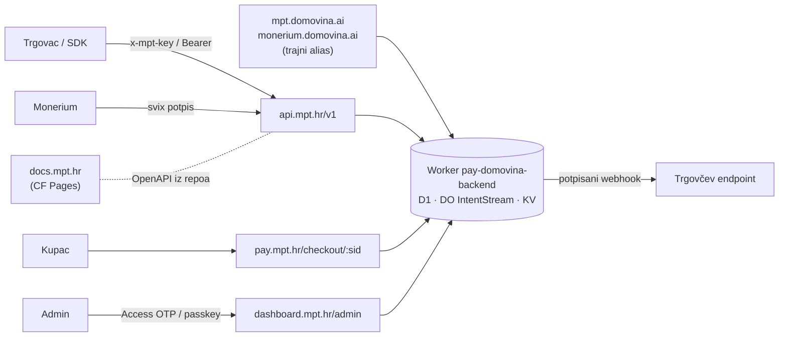

# ADR 0021 — Javni hostovi pod `*.mpt.hr` i API `/v1`; `*.domovina.ai` ostaje trajni alias

- **Status:** Proposed (2026-10-11). Plan je prihvaćen kao smjer, ništa još nije implementirano.
- **Kontekst:** MPT rail Worker `pay-domovina-backend` (`backend/`), admin (`/admin`, Cloudflare
  Access + passkey), checkout (`/checkout/:sid`), Monerium webhookovi po tenantu, klijenti
  (Shopify app, wallet, Flutter `pay.domovina.ai`, pinka), landing `mpt.hr`
- **Gradi na:** [0016](0016-tenant-payout-whitelist.md) (tenant ključevi, whitelist) ·
  [0017](0017-multi-tenant-rail.md) (webhook i secret po tenantu) ·
  `docs/admin-auth.md` (Access + passkey, `ADMIN_HOST`) · `docs/runbook/rate-limits.md`
- **Regresijski ugovor:** faze 1, 2 i 4 samo dodaju ponašanje; stari testovi prolaze bez izmjena
  (`scripts/compat-check.sh`). Faza 3 mijenja samo konfiguraciju (`ADMIN_HOST`, Access app).

## Problem

Proizvod se zove MPT, landing je na `https://mpt.hr/en`, a sve tehničko živi pod tuđim brendom:

| Danas | Što je |
|---|---|
| `mpt.domovina.ai` | javni API (`/api/intents`), admin (`/admin`), checkout (`/checkout/:sid`) |
| `monerium.domovina.ai` | isti Worker; legacy Monerium webhook i bankovni callback |
| `pay.domovina.ai` | Flutter app (klijent raila, ne API) |
| `mpt-shopify.domovina.ai` | Shopify app Worker |

Trgovac koji dođe s `mpt.hr` vidi u dokumentaciji `domovina.ai`, drugi brend s drugom svrhom
(medijska kuća, wallet). To zbunjuje i otežava povjerenje u plaćanja. Uz to API, admin i checkout
dijele jedan host, pa ih ne možemo zasebno štititi (WAF, Access, cookieji) ni zasebno komunicirati.

## Kako to radi industrija (istraženo 2026-10-11)

| Tvrtka | API | Sandbox | Ostali hostovi |
|---|---|---|---|
| Stripe | `api.stripe.com/v1` + datumska verzija u `Stripe-Version` headeru | isti host, test ključevi | `dashboard.`, `docs.`, `checkout.`, `pay.`, `hooks.` |
| Monerium | `api.monerium.app`, verzija u `Accept` headeru | `api.monerium.dev` | landing `monerium.com`; API na drugoj domeni iste tvrtke |
| Wise | `api.wise.com`, verzija u putanji | `api.wise-sandbox.com` | `api-mtls.transferwise.com` živi godinama nakon rebranda |
| Adyen | `checkout-test.adyen.com/v{N}`, live `{prefix}-checkout-live.adyenpayments.com` | zaseban host | |
| Checkout.com | seli s `api.checkout.com` na `{prefix}.api.checkout.com` | `{prefix}.api.sandbox.checkout.com` | najava + migracija, bez redirecta |
| Revolut Business | `b2b.revolut.com/api/1.0` | `sandbox-b2b.revolut.com` | |
| GoCardless | `api.gocardless.com` + obavezni `GoCardless-Version` header | `api-sandbox.gocardless.com` | |
| Paddle | `api.paddle.com` + `Paddle-Version` | `sandbox-api.paddle.com` | ključevi rade samo u svom okruženju |
| Mollie | `api.mollie.com/v2` | isti host, test ključevi | `docs.`, `my.mollie.com` |
| Circle | `api.circle.com/v1` | `api-sandbox.circle.com` | |

Zaključci:

1. Gotovo svi imaju poddomenu `api.` i verziju u putanji (`/v1`). Nitko od provjerenih ne servira
   javni API kao `brand.com/api`.
2. Oko dvije trećine ima zaseban sandbox host.
3. API na domeni različitoj od landinga postoji (Monerium, Adyen), ali je to uvijek domena **iste
   tvrtke**. API pod domenom drugog brenda (naš slučaj) nismo našli.
4. Kad se API host seli, stari host **ostaje raditi** (Wise godinama, Checkout.com uz najavu).
   Nismo našli nijedan slučaj selidbe API hosta preko HTTP redirecta.

Izvori su na dnu dokumenta.

## Odluka

### Mapa hostova

| Host | Namjena | Što smije servirati |
|---|---|---|
| `mpt.hr`, `www.mpt.hr` | landing (Next.js/OpenNext, zaseban repo) | ništa iz raila; ne postavlja cookie na `.mpt.hr` |
| **`api.mpt.hr`** | javni API `/v1/*`, SSE, Monerium webhookovi po tenantu | `/v1/*`, `/api/*` (legacy putanje), `GET /` health |
| **`pay.mpt.hr`** | kupčeva checkout stranica | `/checkout/*` + ono što checkout poziva (`/api/intents/:sid`, `/stream`) |
| **`dashboard.mpt.hr`** | današnji `/admin` | `/admin/*`; iza Cloudflare Accessa |
| **`docs.mpt.hr`** | dokumentacija za trgovce (OpenAPI + vodiči) | statični CF Pages |
| `sandbox-api.mpt.hr` | sandbox (kasnija faza) | zasebna instanca Workera |
| `status.mpt.hr` | statusna stranica (opcionalno) | **izvan** našeg Cloudflare računa |
| `mpt.domovina.ai`, `monerium.domovina.ai` | **trajni alias**: sve kao danas | sve, bez ograničenja po hostu |

Svi novi hostovi (osim `docs.` i `status.`) idu na **isti Worker**. Dodajemo routeove, ne nove
deploymente. Jedan izvor istine za podatke, jedan deploy.

### Pravila

**P1. Stari hostovi su alias, nikad redirect.** `mpt.domovina.ai` i `monerium.domovina.ai`
odgovaraju izravno, zauvijek, s istim ponašanjem kao danas (bajt-identični odgovori). Razlozi:
- kod 301/302 klijenti POST pretvaraju u GET (RFC 9110 §15.4);
- Fetch standard i curl brišu `Authorization` header pri redirectu na drugi host, pa bi poziv
  stigao bez ključa;
- webhook pošiljatelji ne prate redirecte (Stripe 3xx tretira kao neuspjeh), a niz neuspjeha
  kod Monerija deaktivira pretplatu;
- trgovci su spremili `checkout_url` u narudžbe, isprintali linkove, ugradili host u kod.

Jedina iznimka: `GET` na `/admin*` s ne-admin hosta → 301 na `ADMIN_HOST`. To već radi
(`backend/src/admin/auth/mount.ts:64-73`) i sigurno je jer je samo GET u pregledniku.

Stari hostovi **nisu deprecated** i ne dobivaju `Deprecation`/`Sunset` headere. Samo se više ne
spominju u dokumentaciji. Ako se ikad odluči ugasiti ih, to traži novi ADR, najavu od najmanje
12 mjeseci i mjerenje prometa po hostu (P12) koje pokaže nulu.

**P2. Javna površina `/v1`.** `/v1` je ugovor s trgovcima. Ulazi samo ono što trgovac zove:

| `/v1` putanja | Handler (isti kao danas) |
|---|---|
| `POST /v1/intents` | `POST /api/intents` |
| `GET /v1/intents/:sid` | `GET /api/intents/:sid` |
| `GET /v1/intents/:sid/stream` | `GET /api/intents/:sid/stream` (SSE) |
| `GET /v1/intents/campaign-qr` | `GET /api/intents/campaign-qr` |

Implementacija: isti Hono router montiran i pod `/v1/intents` i pod `/api/intents`. Nema kopije
logike i nema internog rewritea koji bi mijenjao `c.req.url`.

**Ne** ulaze u `/v1` (interni, operativni ili partnerski endpointi, ostaju samo pod `/api/*`):
`/api/hpb/*`, `/api/monerium/orders*`, `/api/*/admin/*`, `/api/wallets*`, `/api/gp*`,
`/api/onchain/scan`, `/api/og-preview`. Kad neki od njih postane javan, dobiva `/v1` putanju i
mjesto u OpenAPI specifikaciji.

Monerium webhook nije dio ugovora s trgovcima, nego naš ugovor s Moneriumom. Ostaje na postojećoj
putanji: `https://api.mpt.hr/api/monerium/webhook/t/:tenantId`. Ne verzioniramo ga, jer verziju
payloada određuje Monerium.

**P3. Linkovi u odgovorima.** Danas `intentResponseJson` gradi linkove iz hosta zahtjeva
(`backend/src/intents/api.ts:262-264`). Pravilo:

| Zahtjev stigao na | `status_url`, `status_stream_url` | `checkout_url` |
|---|---|---|
| legacy host + `/api/intents` | kao danas: isti host, `/api/intents/...` | kao danas: isti host, `/checkout/...` |
| `api.mpt.hr` + `/v1/intents` | `https://api.mpt.hr/v1/intents/...` | `${PUBLIC_CHECKOUT_BASE}/checkout/...` → `https://pay.mpt.hr/checkout/...` |
| `api.mpt.hr` + `/api/intents` | `https://api.mpt.hr/api/intents/...` | `${PUBLIC_CHECKOUT_BASE}/checkout/...` |
| lokalno (`localhost`, `wrangler dev`) | origin zahtjeva | origin zahtjeva |

Legacy odgovori ostaju bajt-identični, pa stari testovi i stare integracije ne vide promjenu.
`PUBLIC_CHECKOUT_BASE` je nova env varijabla. Ako nije postavljena, ponašanje je kao danas
(origin zahtjeva), pa je i deploy bez nje siguran.

**P4. Ograničenje po hostu (obrana u dubinu).** Middleware na početku `index.ts` provjerava
dopuštene putanje po hostu iz tablice mape hostova. Na krivom hostu vraća 404 (`wrong_host`) s
točnim hostom u tijelu, nikad redirect. Legacy hostovi i `localhost` su izuzeti, pa nema promjene
ponašanja. Tako `pay.mpt.hr` ne izlaže admin ni operativne endpointe, a `dashboard.mpt.hr` ne
izlaže javni API. Popis je u kodu kao konstanta, s testom za svaki host.

**P5. Admin na `dashboard.mpt.hr`.**
- `ADMIN_HOST = "dashboard.mpt.hr"`. Redirect starih admin URL-ova radi postojeći middleware.
- Nova Cloudflare Access aplikacija s destinacijom `dashboard.mpt.hr/admin/sso`, ista politika
  („MPT admini“), novi `ACCESS_AUD`. Stara aplikacija se briše tek kad nova radi.
- Passkey: `rpID = url.hostname` (`backend/src/admin/auth/passkey.ts:31`), pa passkeyevi
  registrirani na `mpt.domovina.ai` **ne rade** na novom hostu. Admini se prvi put prijave preko
  Access OTP-a i dodaju novi passkey. Stari redovi u `admin_passkeys` mogu ostati ili se obrisati
  ručno (nisu opasni, jer RP ID ne odgovara).
- `rpID` ostaje točan host (`dashboard.mpt.hr`), ne `mpt.hr`. Uži opseg znači da passkey ne
  vrijedi na drugim poddomenama.
- Cookie ostaje `__Host-mpt_admin` (bez `Domain`), pa ga landing ni druge poddomene ne mogu
  pročitati ni podmetnuti („cookie tossing“). Nakon selidbe svi se jednom ponovno prijave.
- CSRF provjera (`Origin === origin zahtjeva`) radi neovisno o hostu.

**P6. Monerium webhookovi.**
- Novi URL pretplate ne smije ovisiti o hostu admina. Danas `registerTenantWebhook(origin)` uzima
  origin admin zahtjeva (`backend/src/tenants/railAdmin.ts:147` → `webhookUrlFor`,
  `backend/src/tenants/onboarding.ts:312`). Kad admin ode na `dashboard.mpt.hr`, novi webhookovi bi
  pokazivali na dashboard host. Zato uvodimo `PUBLIC_API_BASE` (`https://api.mpt.hr`) i
  `webhookUrlFor` ga koristi; fallback je origin, kao danas.
- `OWN_WEBHOOK_URL_RE` (`backend/src/admin/opsRoutes.ts:24`) proširuje se na `api.mpt.hr`. Bez
  toga legacy register endpoint odbija svaki `mpt.hr` URL. Regex ostaje sidren (`^…$`) i ne prima
  wildcard poddomene.
- **Selidba postojećih pretplata bez rupe:** današnji `registerTenantWebhook` najprije **gasi**
  staru pretplatu i **rotira secret** (MT-05). To je ispravno za rotaciju, ali za selidbu hosta
  ostavlja rupu od nekoliko sekundi. Za selidbu uvodimo zasebnu akciju „premjesti webhook na
  novi host“:
  1. kreira novu pretplatu na `PUBLIC_API_BASE` s **istim** secretom (secret generiramo mi i
     šaljemo ga Moneriumu), pa verifikator ne treba nikakvu promjenu;
  2. čeka `subscription.created` ili prvi uredno potpisan događaj na novom URL-u;
  3. tek tada gasi staru pretplatu i sprema novi `webhook_subscription_id`.

  Dok traju obje pretplate, svaki događaj stiže dvaput. Duplikate već hvata idempotencija
  (forward samo na `order.updated` + `processed`, provjera postojećeg forwarda, upsert
  `monerium_orders` po order id). Prije selidbe to se potvrđuje testom: isti potpisani payload
  dvaput daje jedan forward i jedan `payment.received`.
- Legacy pretplata ITalka (`monerium.domovina.ai/api/monerium/webhook`, secret iz env-a,
  postavljena u Monerium dashboardu) **ostaje kako jest**. Selidba je opcionalna i ručna.
- Ruta na starom hostu ostaje zauvijek: pretplata koju netko zaboravi preseliti i dalje radi.
- Propušteni događaj (bilo kad, ne samo u selidbi) hvata postojeći reconcile cron.

**P7. Webhookovi koje mi šaljemo trgovcima.** Payload ne sadrži naš host, pa selidba na njih ne
utječe. Uz `/v1` dokumentiramo: HMAC-SHA256 potpis, retry raspored i polje `api_version: "v1"` u
payloadu (dodavanje polja nije breaking). Ne obećavamo IP allowlist: Workers nemaju fiksne izlazne
IP-ove, a i Checkout.com savjetuje da se ne allowlista.

**P8. Politika verzioniranja `/v1`.**
- **Nije breaking** (ide u `/v1` bez najave): novo polje u odgovoru, novi opcionalni parametar, nova
  vrijednost tipa događaja, novi endpoint. Trgovci moraju ignorirati nepoznata polja; to piše u
  dokumentaciji.
- **Breaking:** uklanjanje ili preimenovanje polja, promjena tipa ili značenja, novo obavezno polje,
  promjena statusnog koda ili stanja. Ide isključivo u `/v2`, a `/v1` radi najmanje 12 mjeseci
  nakon najave.
- Header ili datumsko verzioniranje (Stripe) uvodimo samo ako bude trebalo mijenjati ponašanje
  bez `/v2`. Za mali tim je putanja jednostavnija: vidi se u svakom logu, lako se rutira i kešira.
- Legacy `/api/intents` se ponaša kao `/v1`. Breaking promjena tamo je zabranjena istim pravilom.

**P9. Sandbox `sandbox-api.mpt.hr` (kasnija faza).** Zasebna instanca istog koda (`wrangler
--env sandbox`): vlastiti D1, KV i Durable Object, Monerium `api.monerium.dev`, testnet chain,
ključevi `pk_test_`/`sk_test_`. Svako okruženje odbija ključ drugog okruženja po prefiksu. Isti
host s test ključevima (Stripe) odbačen je jer bi jedan Worker morao po zahtjevu birati Monerium
okruženje, chain, signera i bazu, a to je novi izvor grešaka s novcem.

**P10. Dokumentacija `docs.mpt.hr`.** Izvor istine je OpenAPI specifikacija u repou
(`docs/api/openapi.yaml`), renderirana na CF Pages. Test usporedi rute `/v1` u kodu sa
specifikacijom, pa ne mogu otići u raskorak. Primjeri koriste isključivo `api.mpt.hr` i
`pay.mpt.hr`. Zastarjeli `docs/integrations/shopify-woocommerce-gateway.md` (spominje
nepostojeće `/api/qr/epc` i `/c/<id>`) ispravlja se ili briše.

**P11. DNS, TLS i sigurnost zone `mpt.hr`.** Utvrđeno 2026-10-11:
- `mpt.hr` je već na Cloudflareu (NS `jessica`/`nitin`, isti par kao `domovina.ai`). Prije faze 1
  treba potvrditi da je zona u **istom računu** (`7dc7167b…`); Worker route i Access to zahtijevaju.
- Universal SSL pokriva poddomene prve razine (`api.`, `pay.`, `dashboard.`, `sandbox-api.`).
  Višerazinske (`api.sandbox.mpt.hr`) bi tražile Advanced Certificate Manager. Zato `sandbox-api.`,
  a ne `api.sandbox.`.
- CAA zapis danas ne postoji. Ako se doda, mora dopustiti CA-ove koje Cloudflare koristi, inače
  Universal SSL prestaje obnavljati certifikate.
- Uključiti DNSSEC na `mpt.hr` (zona `.hr` je potpisana, ali domena samo ako vlasnik to uključi).
- HSTS s `includeSubDomains` tek kad su sve poddomene na HTTPS-u; `preload` tek nakon toga, jer
  se teško povlači.
- E-mail ide preko Google Workspacea (MX `aspmx.l.google.com`, SPF `-all`). DMARC zapis ne postoji;
  dodati `_dmarc.mpt.hr` (prvo `p=none` s izvještajima). Nije nužno za API, ali trgovci će dobivati
  mail s te domene.
- Landing je Worker (OpenNext) u drugom repou. Provjeriti da njegov route nije wildcard koji bi
  progutao poddomene (`*mpt.hr/*`). Cloudflare primjenjuje najspecifičniji pattern, ali to treba
  vidjeti u dashboardu prije faze 1.
- WAF i rate-limit pravila su **po zoni**. Pravila iz `docs/runbook/rate-limits.md` treba upisati i u
  zonu `mpt.hr`, ne samo u `domovina.ai`. Free plan ima ograničen broj rate-limit pravila po zoni, pa
  to treba provjeriti.

**P12. CORS i opažanje.**
- `ALLOWED_ORIGINS` provjerava origin **pozivatelja**, pa novi serverski hostovi ne trebaju ulaziti
  u njega. Dodaju se samo origini koji iz preglednika zovu API: `https://mpt.hr`,
  `https://www.mpt.hr` (ako landing ikad prikazuje živi status), `https://docs.mpt.hr` (ako dobije
  „isprobaj“ konzolu). `pay.mpt.hr` ne treba, jer checkout zove isti host relativnim putanjama.
- Svaki zahtjev logira host i prefiks (`/v1` ili `/api`) kao strukturirano polje. Tako se vidi koliko
  prometa još ide na legacy hostove i putanje.
- Uptime provjera (`GET /`) na `api.mpt.hr` i `mpt.domovina.ai`.

## Rubni slučajevi

| Slučaj | Što se događa | Mjera |
|---|---|---|
| Trgovac ima `mpt.domovina.ai` zakucan u kodu | radi zauvijek, odgovori bajt-identični | P1 |
| Spremljen ili isprintan `checkout_url` na starom hostu | radi zauvijek | P1; `/checkout/*` se nikad ne ograničava na legacy hostu |
| Stari Shopify app s `MPT_API_BASE = mpt.domovina.ai` | radi; novi appovi dobivaju `api.mpt.hr` | `shopify/worker/wrangler.toml`, `scripts/new-merchant-app.sh` |
| EPC/HUB3 QR već isprintan | ne sadrži hostname (`mpt:0x…?sid=…` + IBAN) | nema utjecaja |
| Klijent šalje POST na stari host i očekuje redirect | ne dobiva ga, dobiva odgovor | P1 |
| Bearer ključ preko redirecta | ne događa se, jer redirecta za API nema | P1 |
| Admin forma otvorena na starom hostu, POST nakon selidbe | 421 `wrong_admin_host` (postojeće ponašanje) | admin osvježi stranicu; dokumentirano |
| Admin passkey sa starog hosta | ne radi na `dashboard.mpt.hr` (RP ID) | prijava Access OTP-om, novi passkey |
| Admin cookie sa starog hosta | ne prenosi se (`__Host-`) | jednokratna ponovna prijava |
| Novi tenant webhook registriran nakon selidbe admina | bez P6 bi pokazivao na `dashboard.mpt.hr` | `PUBLIC_API_BASE` u `webhookUrlFor` |
| Selidba webhooka: dvije aktivne pretplate | dvostruke isporuke | idempotencija + test prije selidbe |
| Selidba webhooka: nova pretplata ne prođe validaciju | stara još radi | stara se gasi tek nakon prvog uspješnog događaja |
| Re-register (rotacija) usred selidbe | MT-05 gasi trenutnu i rotira secret | akcija selidbe i rotacija se međusobno isključuju (zaključavanje po tenantu) |
| Zaboravljena stara pretplata | i dalje isporučuje na legacy host | ruta na legacy hostu ostaje zauvijek |
| Monerium ograniči broj pretplata po računu | nova se ne može kreirati dok je stara aktivna | provjeriti prije faze 4; fallback: ugasi pa kreiraj + reconcile |
| Bankovni SCA callback (`monerium.domovina.ai/api/hpb/callback`) | registriran kod Enable Bankinga i GoCardlessa | ne seli se; nije javni API |
| `INTENT_WEBHOOK_URL` prema pinki (`api.domovina.ai`) | odlazni poziv prema pinki | ne mijenja se; nije naš host |
| SSE na novom hostu | Durable Object je vezan uz `sid`, ne uz host | nema utjecaja; `/v1/.../stream` isti handler |
| SSE cross-origin iz walleta | radi kao danas (CORS po pozivatelju) | nema utjecaja |
| Checkout na `pay.mpt.hr` poziva API | relativne putanje, isti Worker | P4 dopušta `/api/intents/:sid*` na `pay.` |
| `pay.mpt.hr/admin` ili `pay.mpt.hr/api/hpb/...` | 404 `wrong_host` (admin GET → 301 na `ADMIN_HOST`) | P4 |
| Zahtjev na `/v1/...` putanju koja ne postoji | 404 JSON, ne pada na `/api` | P2 |
| `wrangler dev` uzima prvi route kao host | lokalni origin; P3 i P4 izuzimaju `localhost` | postojeća `isLocal` provjera |
| Landing postavi analytics cookie na `.mpt.hr` | šalje se i API-ju (bezopasno, API ne čita cookie) | landing koristi host-only cookie; admin štiti `__Host-` |
| CAA zapis dodan bez Cloudflare CA-ova | obnova certifikata padne | P11 |
| DNSSEC uključen pa NS promijenjen bez DS ažuriranja | domena prestane resolvirati | DS mijenjati zajedno s NS-om; zapisati u runbook |
| WAF pravila samo na `domovina.ai` | `api.mpt.hr` bez rate-limita na rubu | P11; kapice u kodu vrijede i bez WAF-a |
| Wildcard route landinga | proguta `api.mpt.hr` | provjeriti prije faze 1 (P11) |
| Promjena polja u `/v1` odgovoru | breaking? | P8 lista |
| Sandbox ključ na produkciji ili obratno | odbijen po prefiksu | P9 |
| Jedan tenant ima integraciju na oba hosta | oba rade nad istim podacima | jedan Worker, jedan D1 |

## Što se mijenja u kodu (inventar, bez implementacije)

| Mjesto | Promjena | Faza |
|---|---|---|
| `backend/wrangler.toml:21-27` | route `api.mpt.hr/*` (zona `mpt.hr`); kasnije `pay.`, `dashboard.` | 1 / 2 / 3 |
| `backend/src/index.ts` | mount `/v1/intents`; host middleware (P4); log polje host + prefiks | 1 |
| `backend/src/intents/api.ts:262-264` | linkovi po P3 (prefiks putanje, `PUBLIC_CHECKOUT_BASE` samo za ne-legacy hostove) | 1 / 2 |
| `backend/src/admin/opsRoutes.ts:24-25` | `OWN_WEBHOOK_URL_RE` + `api.mpt.hr` | 1 |
| `backend/src/tenants/onboarding.ts:312` | `webhookUrlFor` koristi `PUBLIC_API_BASE` | 1 |
| `backend/src/tenants/onboarding.ts` + `railAdmin.ts` | akcija „premjesti webhook“ (isti secret, pa gašenje stare) | 4 |
| `backend/src/types.ts` | `PUBLIC_API_BASE`, `PUBLIC_CHECKOUT_BASE` | 1 |
| `backend/wrangler.toml:131-133` | `ADMIN_HOST`, `ACCESS_AUD` | 3 |
| `backend/src/admin/views.ts:2,386` | prikazani webhook URL čita se iz env-a, ne zakucan | 1 |
| `backend/wrangler.toml:62` | `ALLOWED_ORIGINS` + `mpt.hr` origini (P12) | 1 |
| `shopify/worker/wrangler.toml`, `scripts/new-merchant-app.sh`, `extensions/mpt-payment-qr/src/config.js` | zadani `MPT_API_BASE = https://api.mpt.hr` za nove appove | 5 |
| `wallet/src/lib/constants.ts:56` | zadani `PAYMENT_INTENT_API_BASE` | 5 |
| `lib/services/intent_service.dart:14-17` | zadani `MPT_BACKEND_URL` | 5 |
| `docs/api/openapi.yaml` (novo), `docs.mpt.hr` | specifikacija + test usklađenosti ruta | 5 |
| `docs/admin-auth.md`, `docs/runbook/rate-limits.md`, `README.md`, `docs/product-vision/payment-intents-and-sse.md` | novi hostovi; stari kao alias | uz svaku fazu |

Stari testovi (`backend/test/adminAuth.test.ts`, `onboarding.test.ts`, `webhookRoute.test.ts`, …)
koriste vlastite env fixturee s `mpt.domovina.ai` i ostaju nepromijenjeni. Novi testovi pokrivaju
`/v1` putanje, P3 tablicu, P4 matricu host × putanja, regex i dvostruku isporuku webhooka.

## Faze

Svaka faza ima uvjet završetka i povratak. Povratak nikad ne dira legacy hostove, jer se oni ne
mijenjaju.

| # | Faza | Završeno kad | Povratak |
|---|---|---|---|
| 0 | **Priprema zone:** potvrditi isti CF račun, provjeriti route landinga, DNSSEC, DMARC `p=none`, WAF pravila za zonu `mpt.hr` | sve stavke P11 zapisane u runbook | — |
| 1 | **`api.mpt.hr` + `/v1`:** route, mount, P3 (bez checkout hosta), P4, regex, `PUBLIC_API_BASE`, CORS, logovi | `curl https://api.mpt.hr/v1/intents` kreira intent; compat-check zelen; legacy odgovori bajt-identični (snapshot test) | maknuti route |
| 2 | **`pay.mpt.hr`:** route + `PUBLIC_CHECKOUT_BASE` | intent s `api.mpt.hr` vraća `checkout_url` na `pay.mpt.hr`; plaćanje 1 € prođe do `paid` na SSE-u | isprazniti `PUBLIC_CHECKOUT_BASE` |
| 3 | **`dashboard.mpt.hr`:** Access app, `ADMIN_HOST`, `ACCESS_AUD`, novi passkeyevi | oba admina prijavljena OTP-om i passkeyem; stari `/admin` URL-ovi 301 | vratiti `ADMIN_HOST` i `ACCESS_AUD` (stara Access app se ne briše do kraja faze) |
| 4 | **Selidba Monerium webhookova po tenantu** (P6) | svaki aktivni tenant ima pretplatu na `api.mpt.hr`; stare ugašene; reconcile bez propuštenih | stara ruta i dalje radi; ponovno kreirati staru pretplatu |
| 5 | **Klijenti i dokumentacija:** zadani base URL-ovi, OpenAPI, `docs.mpt.hr`, landing linkovi | nijedan javni dokument ne spominje `*.domovina.ai` kao API | — |
| 6 | **Sandbox** (P9), po potrebi | prvi trgovac integrira bez dodira produkcije | — |

Faze 1 i 2 su neovisne o fazi 3. Faza 4 traži fazu 1 i `PUBLIC_API_BASE`, a ne fazu 3.

## Odbačeno

- **HTTP redirect sa starog na novi host** za API i webhookove: lomi POST, briše `Authorization`,
  webhook pošiljatelji ga ne prate (P1).
- **Gašenje starih hostova s rokom:** nema troška u zadržavanju (jedna linija u `[[routes]]`), a
  rizik prekida plaćanja je stvaran. Wise drži legacy host godinama.
- **Admin pod `api.mpt.hr/admin`:** Access ne može stajati ispred hosta koji zovu strojevi, a dijeljeni
  host miješa WAF, CORS i cookie pravila.
- **`hooks.mpt.hr` za ulazne webhookove:** čišća WAF pravila, ali još jedan host i certifikat bez
  stvarne koristi pri našem prometu. Može se dodati kasnije kao alias.
- **Sandbox na istom hostu s test ključevima:** P9.
- **`api.mpt.hr` bez verzije:** svaka buduća breaking promjena bi tada tražila novi host ili header.
  `/v1` od prvog dana je jeftin.
- **Passkey `rpID = mpt.hr`:** passkey bi vrijedio na svim poddomenama, uključujući landing iz drugog
  repoa. Uži RP ID je sigurniji, a admina su dvojica.
- **Selidba na `.com` ili `.eu`:** `mpt.hr` je ono što imamo i što komuniciramo; `.hr` odgovara
  hrvatskoj tvrtki s HUB3 i HR IBAN-ima (ADR 0020). Obrambena registracija `mpt.eu` je opcionalna.

## Otvorena pitanja

- Je li zona `mpt.hr` u računu `7dc7167b…`? (NS par je isti kao za `domovina.ai`, što to sugerira,
  ali nije dokaz.)
- Ograničava li Monerium broj webhook pretplata po računu (P6 dvostruka pretplata)?
- Koliko rate-limit pravila dopušta plan zone `mpt.hr`?
- Treba li `mpt-shopify.domovina.ai` preseliti na `shopify.mpt.hr`? Shopify app URL je u
  `shopify.app.toml` i kod Shopifyja, pa to znači novu verziju appa za svakog trgovca. Za sada ne.
- Gdje hostati `status.mpt.hr` (vanjski servis), i treba li uopće prije prvog većeg trgovca?

## Izvori

- Stripe: https://docs.stripe.com/api/versioning · https://docs.stripe.com/ips ·
  https://support.stripe.com/questions/webhooks-what-to-do-when-the-http-status-code-starts-with-a-three-(3xx)
- Monerium: https://docs.monerium.com/api
- Wise: https://docs.wise.com/guides/partner-account ·
  https://docs.wise.com/guides/developer/environments/sandbox-v2-migration.md
- Adyen: https://docs.adyen.com/development-resources/live-endpoints/
- Checkout.com: https://support.checkout.com/hc/en-us/articles/31223852975762-Migrate-to-unique-API-base-URLs ·
  https://www.checkout.com/docs/developer-resources/api/api-endpoints
- Mollie: https://docs.mollie.com/reference/authentication
- Revolut: https://developer.revolut.com/docs/guides/manage-accounts/get-started/prepare-sandbox-environment
- GoCardless: https://docs.gocardless.com/docs/api-reference/making-requests
- Paddle: https://developer.paddle.com/api-reference/about
- Circle: https://developers.circle.com/digital-asset-accounts/references/testing-in-sandbox
- Redirect i `Authorization`: RFC 9110 §15.4 ·
  https://groups.google.com/a/chromium.org/g/blink-dev/c/3Zt4UHbynYA/m/EubTuK4iAgAJ ·
  https://github.com/whatwg/fetch/issues/1631
- Cookie tossing / izolacija poddomena: https://github.blog/news-insights/product-news/new-github-pages-domain-github-io ·
  https://github.blog/engineering/yummy-cookies-across-domains/
- `.hr` zona: https://www.iana.org/domains/root/db/hr.html
