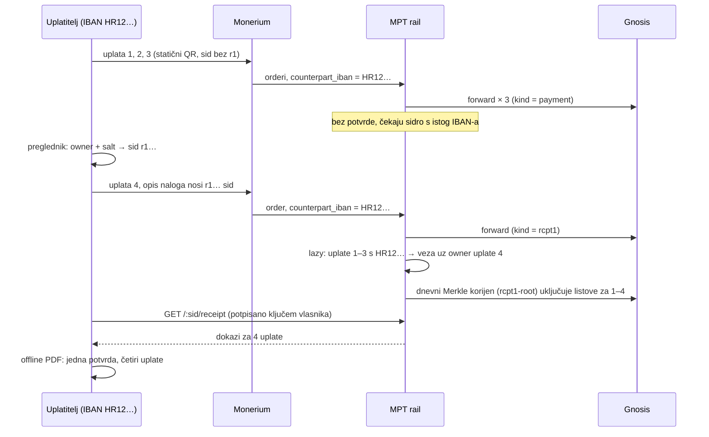

# ADR 0022 — Potvrda o uplati vezana uz ključ uplatitelja: `sid` = otisak ključa, offline PDF, sidrenje na Gnosisu i OpenTimestamps

- **Status:** Proposed (2026-10-12). Ništa još nije implementirano.
- **Kontekst:** MPT rail (`backend/`), intent API (`backend/src/intents/api.ts`), generator `sid`-a
  (`backend/src/intents/sid.ts`), `PaymentRegistry` (`backend/contracts/PaymentRegistry.sol`),
  forward s `registry.record(...)` (`backend/src/router/safe.ts`), checkout stranica i Flutter
  `pay.domovina.ai`, wallet.domovina.ai
- **Gradi na:** [0001](0001-no-server-side-recovery.md) (self-custody: dokaz ne smije ovisiti o
  našoj bazi) · [0012](0012-recovery-seed-second-owner-interop.md) (oporavak Safe-a) ·
  [0016](0016-tenant-payout-whitelist.md) (`memo_prefix`) · [0018](0018-stray-payment-resolver.md)
  (uplate bez reference) · [0020](0020-hr-iban-listener-bez-minta.md) (HUB3, bez `sid`-a u opisu)
- **Regresijski ugovor:** samo dodaje ponašanje. Postojeći `sid`-ovi i njihov format ostaju
  nepromijenjeni, a stari testovi prolaze bez izmjena (`scripts/compat-check.sh`).

## Problem

Želimo da uplatitelj, kad je uplata vidljiva, može spremiti **potvrdu o uplati**. Potvrda mora
imati ova svojstva:

1. Može se provjeriti i za deset godina, bez MPT servera i baze.
2. Na temelju nje se u budućnosti mogu preuzeti prava, npr. claim tokena ili glas.
3. **Nitko drugi je ne može preuzeti**: ni onaj tko vidi lanac ili izvod, ni trgovac, ni MPT.
4. Radi i za anonimnog uplatitelja, bez računa na domovina-api.

### Zašto današnji `sid` ne zadovoljava (3)

`sid` je javan po konstrukciji:

| Gdje je vidljiv | Tko ga vidi |
|---|---|
| opis SEPA naloga (`mpt:0x…?sid=…`) | uplatiteljeva banka, Monerium, MPT |
| `Payment(bytes32 indexed sessionId, …)` na Gnosisu | svi |
| `GET /api/intents/:sid` | svi koji znaju `sid` |
| QR na checkout stranici ili posteru | svi koji ga vide |

Potvrda „platio sam `sid` X" zato dokazuje **da je** uplata postojala, a ne **tko** ju je
napravio. Ako bi `sid` bio uvjet za claim, svatko tko čita lanac mogao bi preuzeti tuđe pravo.

### Zašto ne rješenje preko prijave (domovina-api)

Prijavljeni korisnik bi dobio potvrdu jer backend kaže „intent je stvorio korisnik 123". To je
tvrdnja naše baze. Ona ne preživljava gašenje servisa, MPT je može krivotvoriti, a ne radi za
anonimne uplatitelje. Kršila bi duh ADR 0001: dokaz o vlasništvu ne smije ovisiti o nama.

## Odluka

### 1. `sid` je kriptografska obveza na ključ uplatitelja

Uplatiteljev uređaj **prije plaćanja** odredi vlasnika potvrde i iz njega izvede `sid`:

```
owner   = adresa (EOA iz ephemeral ključa ILI adresa Safe-a)
salt    = 16 nasumičnih bajtova
digest  = keccak256( "MPT-RECEIPT-v1" ‖ owner ‖ salt )
sid     = "r1" ‖ base32(digest)[0:24]        // 26 znakova, 120 bitova
```

- Abeceda je ista kao u `generateSid()` (32 znaka, bez 0/O/1/l/I), pa je to 5 bitova po znaku.
- 26 znakova stane u `SID_RE` (`^[A-Za-z0-9_-]{6,32}$`) i u `bytes32` (`asciiToBytes32`).
  **Backend validacija se ne mijenja.**
- Prefiks `r1` razlikuje `sid` vezan uz potvrdu od starih, nasumičnih. Stari `sid` od 12 znakova
  nikad ne počinje s `r1` i ima 26 znakova, pa sudara nema.
- `salt` služi privatnosti. Bez njega bi svatko tko zna nečiju Safe adresu mogao provjeriti je li
  ta adresa platila određeni `sid`.
- 120 bitova znači da napadač za tuđi `sid` mora naći drugu predsliku (second preimage) od 2^120
  pokušaja. To je izvan dosega i državnih aktera.

Uplatitelj **sam** upisuje `sid` u svoj bankovni nalog (EPC QR ga prenosi). Zato ni MPT ni
trgovac ne mogu naknadno podmetnuti drugog vlasnika: `sid` u nalogu već drži obvezu na ključ.
Monerium je neovisan svjedok, jer njegov order bilježi opis naloga onako kako ga je banka poslala.

`POST /api/intents` već prima `sid` koji je generirao klijent (`body.sid`, `intents/api.ts:42`),
pa za stvaranje intenta ne treba novi endpoint.

### 2. Tri razine vlasnika

| Razina | `owner` | Kako se dokazuje vlasništvo | Napomena |
|---|---|---|---|
| **Wallet (preporučeno)** | adresa Safe-a s wallet.domovina.ai | ERC-1271 potpis (passkey ili seed) | Nema tajne u PDF-u. Gubitak passkeyja pokriva oporavak Safe-a (ADR 0012). Safe smije biti counterfactual, a deploy ide pri prvom claimu. |
| **Anonimno** | adresa ephemeral secp256k1 ključa generiranog u pregledniku | ECDSA potpis tim ključem | PDF nosi ključ, pa je **bearer instrument**: tko ima ključ, ima pravo. Ključ je zato u zasebnom dijelu PDF-a i po želji enkriptiran (§4). |
| **Bez potvrde** | — | — | Današnji nasumični `sid`. Ponašanje je nepromijenjeno. |

Prijava na domovina-api **nije** razina vlasnika. Može postojati kao pogodnost (pohrana
enkriptiranog ključa), ali izvor istine je uvijek potpis vlasnika.

### 3. Kada se potvrda izdaje odmah, kada naknadno, a kada nikad

Potvrda ima dvije razine sigurnosti:

- **Izravna (`rcpt1`).** Vlasnik je kriptografski vezan uz uplatu preko `sid`-a koji je uplatitelj
  sam stavio u nalog. Ne traži povjerenje u MPT (osim rezidualnog, vidi Model prijetnji).
- **Naknadna (`rcpt1-lazy`, §3a).** Vlasnik je vezan uz uplatu preko **IBAN-a uplatitelja**:
  ista bankovna osoba je kasnije napravila izravnu potvrdu. Ovu vezu atestira MPT na temelju
  Moneriumovih podataka o uplatitelju, pa je razina povjerenja niža. Claim program sam odlučuje
  prihvaća li je.

Stray resolver (ADR 0018) pridružuje uplatu bez reference intentu po tenantu, iznosu i vremenu.
To je dovoljno dobro za isplatu trgovcu, ali **ne dokazuje tko je platio**. Dva uplatitelja s
istim iznosom u istom prozoru nerazlučivi su, pa bi resolver mogao tuđu uplatu „upisati" na
nečiji `r1` intent. Zato stray nikad ne daje izravnu potvrdu, ali može dobiti naknadnu, jer IBAN
iz Moneriumovog ordera ne ovisi o tome kojem je intentu resolver uplatu pridružio.

Oznaka u forwardu:

| `memo_prefix` forwarda | `kind` u `Payment` eventu |
|---|---|
| `mpt`, `cmp` (`sid` stigao u opisu naloga) i `sid` počinje s `r1` | `rcpt1` |
| `auto`, `manual` (ADR 0018) i `sid` počinje s `r1` | `rcpt1-unbound` |
| bilo koji, `sid` bez `r1` | kao danas (`payment`, …) |

Oznaka je **na lancu**, u istoj transakciji kao prijenos EURe. Za izravnu potvrdu verifikator i
claim ugovor ne moraju pitati MPT kakvo je bilo uparivanje.

#### Potpuna matrica slučajeva

| # | Slučaj | Izravna potvrda | Naknadna potvrda (§3a) | Zašto |
|---|---|---|---|---|
| 1 | `r1` intent, `sid` stigao u opisu naloga (`mpt`/`cmp`) | **da, odmah** | — (ona je sidro) | uplatitelj je sam upisao obvezu na ključ |
| 2 | `r1` intent, ali uplata bez reference i stray resolver ju je pridružio (`auto`/`manual`) | ne | **da** | uparivanje po iznosu i vremenu ne dokazuje uplatitelja, IBAN dokazuje |
| 3 | statični QR kampanje, ponovno upotrebljivi QR, legacy `sid` bez `r1` | ne | **da** | `sid` je javan i dijeljen, nema ključa |
| 4 | uplata bez reference koja je isplaćena izvan raila (`resolved_offrail`) ili ručno preusmjerena | ne | **da** | Moneriumov order i mint postoje, IBAN je poznat |
| 5 | uplata iz razdoblja prije ove odluke | ne | **da**, ako order ima `counterpart_iban` | `monerium_orders.counterpart_iban` se sprema od migracije 0002 |
| 6 | Moneriumov order bez `counterpart_iban` | ne | **ne** | nema čime upariti |
| 7 | uplata vraćena uplatitelju (refund, povrat, odbijena) | ne | **ne** | novac nije ostao kod primatelja |
| 8 | podaci o uplatitelju obrisani (GDPR brisanje, istek čuvanja) | ne | **ne** | nema čime upariti, a brisanje se ne zaobilazi |
| 9 | HUB3 / HR IBAN listener (ADR 0020) | ne | **ne** u ovoj odluci | nema minta ni `Payment` eventa; poziv na broj nosi najviše ~73 bita, premalo protiv drugog predslika. Gateway možda zna IBAN uplatitelja, pa je naknadna potvrda moguća u zasebnom ADR-u |
| 10 | izravna on-chain EURe uplata (EIP-681, bez SEPA-e) | ne kroz ovaj mehanizam | ne | nema IBAN-a. Vlasnik je ionako `from` adresa iz `Transfer` loga, koja se dokazuje bez MPT-a (poseban tip potvrde, izvan opsega) |
| 11 | način `direct` (ADR 0017) | otvoreno | otvoreno | ovisi o tome postoji li `Payment` event (Otvorena pitanja) |
| 12 | uplata s IBAN-a s kojeg još nikad nije stigla izravna potvrda | ne | **još ne** | postaje potvrđena čim s tog IBAN-a stigne slučaj 1 |

### 3a. Naknadno (lazy) izdavanje preko IBAN-a uplatitelja

**Pravilo.** Kad forward slučaja 1 (`rcpt1`) dobije `confirmed`, uzme se IBAN uplatitelja iz
njegovog Moneriumovog ordera (normaliziran: velika slova, bez razmaka). Sve ranije uplate s
istog IBAN-a koje još nemaju potvrdu postaju potvrđene i vežu se uz vlasnika te izravne potvrde.
IBAN je dovoljan; ime uplatitelja nije uvjet.

**Primjer.** Uplatitelj s `HR12 3456 …` plati tri puta preko statičnog QR-a kampanje (slučaj 3)
i nijedna uplata nema potvrdu. Četvrti put plati preko vlastitog `r1` intenta (slučaj 1). U tom
trenutku nastaje **jedna potvrda za sve četiri uplate**: četvrta je izravna, a prve tri naknadne.



**Pravila uparivanja:**

1. **Sidro** može biti samo izravna potvrda (slučaj 1). `rcpt1-unbound` nije sidro, jer intent
   možda ne pripada osobi koja je platila.
2. **Pokriveno** je svaka uplata iz matrice s „da" u stupcu naknadne potvrde: ista normalizirana
   vrijednost IBAN-a, `placedAt` raniji od sidra, nije vraćena i još nije pokrivena.
3. **Svaka uplata se pokriva najviše jednom** (jedinstveni indeks na identifikatoru uplate). Prvo
   sidro s tog IBAN-a, po `placedAt`, uzima sve što je prije njega. Kasnije sidro s istog IBAN-a
   pokriva samo uplate između prethodnog sidra i sebe.
4. **Uplate nakon sidra** bez vlastitog `r1` ostaju bez potvrde dok s istog IBAN-a ne stigne
   sljedeće sidro. Tada ih ono pokupi po pravilu 3. Automatsko pokrivanje unaprijed se ne radi,
   jer se vlasnik ključa u međuvremenu mogao promijeniti (izgubljen ključ, novi uređaj).
5. **Svi tenanti.** Pokriva se po IBAN-u, neovisno o tenantu, jer je uplatitelj ista osoba. Veza
   nije javna (§ niže), pa tenant B ne saznaje za uplate tenantu A.
6. **Identifikator uplate** je Moneriumov mint na Gnosisu (`chainId`, tx hash, `logIndex`
   `Transfer` loga), jer postoji i za uplate koje nemaju forward kroz MPT Safe (slučaj 4).
   `monerium_orders.tx_hashes` ga već sprema.
7. **Nesigurni slučajevi idu u alarm, ne u blokadu** (isto načelo kao ADR 0018): ako se ime
   uplatitelja na sidru i na pokrivenoj uplati razlikuje, uplata se ipak pokriva, a admin dobije
   Telegram obavijest.

**Zajednički i poslovni računi.** IBAN predstavlja vlasnika računa, ne osobu koja je kliknula
„Pošalji". Kod zajedničkog računa (bračni par) ili poslovnog računa sve ranije uplate idu prvom
vlasniku ključa koji s tog IBAN-a napravi izravnu potvrdu. To je svjesna odluka: alternativa je
da takve uplate nikad ne dobiju potvrdu.

**Gdje se veza zapisuje.** Naknadna veza **nije** zaseban javni event po uplati. Javni event bi
svima pokazao sve uplate jedne osobe (jedan `sid` povezan s N uplata kroz tenante). Umjesto toga:

- svaka veza je list u dnevnom Merkle stablu iz §5:
  `leaf = keccak256("MPT-RECEIPT-LAZY-v1" ‖ anchorSid ‖ chainId ‖ mintTxHash ‖ mintLogIndex ‖ amount)`
- na lanac i u OpenTimestamps ide samo korijen (`kind = "rcpt1-root"`, `amount = 0`,
  `token = 0`, pa ga nijedan indexer ne može pročitati kao uplatu)
- Merkle dokaze vraća `GET /api/intents/:sid/receipt` **samo uz potpis vlasnika** nad svježim
  izazovom. Tko zna samo `sid`, vidi izravnu potvrdu, ali ne i popis ranijih uplata.

**Razina povjerenja.** Naknadna potvrda ovisi o dvije stvari koje lanac ne dokazuje: da je
Monerium točno prijavio IBAN uplatitelja i da je MPT ispravno složio Merkle stablo. Zato je PDF
označava kao „Potvrđeno naknadno, preko IBAN-a uplatitelja", a claim ugovor razlikuje listove
`rcpt1` i `rcpt1-lazy`.

### 4. Offline PDF

Kad intent prijeđe u `confirmed`, uplatiteljev preglednik dohvati javne podatke i **lokalno**
složi PDF. Ključ i `salt` nikad ne napuštaju uređaj.

PDF ima dva dijela:

**A. Potvrda (smije se dijeliti)**

- `sid`, iznos, valuta, tenant (ime i Gnosis adresa primatelja), datum i vrijeme
- Gnosis: `chainId 100`, hash forward transakcije, `logIndex` `Payment` eventa, broj bloka
- `owner` i `salt` (otkrivaju samo vezu `sid` ↔ vlasnik, ne daju pravo na claim)
- kanonski JSON potvrde (RFC 8785 JCS) kao PDF prilog i u QR kodu
- OpenTimestamps dokaz (`.ots`) kao PDF prilog (§5)
- upute za provjeru bez MPT-a: „u bloku N postoji `Payment(sessionId=sid, kind=rcpt1, …)`, a
  `keccak256("MPT-RECEIPT-v1" ‖ owner ‖ salt)` daje taj `sid`"

**B. Ključ za preuzimanje (samo anonimna razina, ne dijeliti)**

- privatni ključ ephemeral vlasnika, kao QR i tekst
- po izboru enkriptiran lozinkom (scrypt, AES-GCM), a podrazumijevano je enkriptiran ako je
  korisnik upisao lozinku
- UI jasno kaže: „Tko ima ovu stranicu, može preuzeti vaše pravo. Ne šaljite je nikome."
- ista tajna ostaje i u `localStorage` preglednika, pa gubitak PDF-a nije nužno i gubitak prava

Za razinu wallet dio B ne postoji.

Dokaz „ja sam taj uplatitelj" pred trećom stranom (npr. organizatorom glasanja) ide izazovom:
verifikator pošalje nasumičnu poruku, a vlasnik je potpiše ključem ili Safe-om. Sama potvrda (A)
dokazuje da uplata postoji, a potpis dokazuje da je pokazivač vlasnik.

### 5. Sidrenje

1. **Primarno: `Payment` event na Gnosis mainnetu.** Već postoji u forward transakciji
   (`registry.record` + `EURe.transfer` u jednom MultiSendu). Dovoljan je za provjeru i claim.
2. **Neovisno: OpenTimestamps na Bitcoinu.** Jednom dnevno backend složi Merkle stablo
   svih `rcpt1` potvrda tog dana i svih naknadnih veza (`rcpt1-lazy` listovi iz §3a). Korijen ide:
   - u `PaymentRegistry.record(sessionId=root, kind="rcpt1-root", recipient=0, token=0, amount=0, metadataURI="")`
     (postojeći ugovor, bez novog deploya)
   - i na OpenTimestamps kalendare.

   PDF generiran odmah nosi „pending" OTS dokaz. Potpun dokaz (nakon Bitcoin potvrde, nekoliko
   sati) uplatitelj preuzme kasnije s `GET /api/intents/:sid/receipt`, a stranica ponudi
   ponovno generiranje PDF-a. Bez potpunog OTS-a potvrda i dalje vrijedi, samo bez drugog sidra.
3. **Chiado se ne koristi za potvrde.** Testnet se može resetirati, pa ne vrijedi kao trajni
   dokaz. Koristi se samo za razvoj i testove claim ugovora.
4. **Potpis MPT-a nije izvor istine.** EIP-712 potpis MPT-ovog „receipt" ključa smije biti
   pogodnost za brzu provjeru, ali rotacija ključa i gašenje servisa ga oslabe. Lanac je dokaz.

### 6. Claim (smjer, ne implementacija)

Budući claim ugovor provjerava:

```
claim(sid, owner, salt, recipient, deadline, signature, paymentProof)
  1. sid == "r1" ‖ base32(keccak256("MPT-RECEIPT-v1" ‖ owner ‖ salt))[0:24]
  2. signature je potpis vlasnika nad EIP-712 Claim{sid, recipient, deadline, chainId, verifyingContract}
     → ecrecover == owner, ili ERC-1271 isValidSignature na owner (Safe)
  3. paymentProof dokazuje Payment(sessionId=sid, kind="rcpt1", sender=MPT Safe) na Gnosisu
     (izravno: storage/receipt proof; ili Merkle dokaz protiv rcpt1-root koji je ugovor zapamtio)
  4. sid nije već iskorišten

claimLazy(anchorSid, owner, salt, recipient, deadline, signature, leaves[], merkleProofs[])
  1–2. isto kao gore, nad anchorSid
  3. svaki list je rcpt1-lazy list s tim anchorSid, uključen u neki zapamćeni rcpt1-root
  4. nijedan (mintTxHash, mintLogIndex) nije već iskorišten
```

Claim program bira hoće li prihvatiti samo `claim`, ili i `claimLazy` (niža razina povjerenja).

Potpis veže `recipient`, pa nema front-runninga: tko vidi transakciju u mempoolu, ne može
preusmjeriti claim na svoju adresu. Ključ se nikad ne otkriva na lancu.

Ako je isti `sid` plaćen više puta (dopušteno za `mpt`/`cmp`, vidi 0018_stray_resolver.sql),
pravo se računa po zbroju svih `rcpt1` eventa za taj `sid`. Konkretna pravila (zbroj ili prvi,
minimalni iznos) odlučuje ADR claim programa, ne ovaj.

## Model prijetnji

| Napad | Ishod |
|---|---|
| Napadač čita lanac ili izvod i zna `sid` | Nema ključ ni `salt`, pa ne može potpisati claim. |
| Napadač grinda ključ čiji digest daje tuđi `sid` | 2^120 pokušaja, neizvedivo. |
| MPT ili trgovac podmeće drugog vlasnika | `sid` je obveza na vlasnika, a uplatitelj ga je sam stavio u nalog. Promjena `sid`-a znači da uplata ne pripada tom intentu. |
| MPT bilježi `Payment` za `sid` koji nije plaćen | Forward bi morao stvarno prenijeti EURe s MPT Safe-a, pa krivotvorenje košta punu vrijednost. **Rezidualno povjerenje:** lanac dokazuje da je MPT router evidentirao uplatu, a ne da je banka primila novac od tog uplatitelja. Neovisni svjedok je Moneriumov order, koji nije javan. |
| Stray resolver pripiše tuđu uplatu `r1` intentu | Event nosi `rcpt1-unbound`, bez izravne potvrde (§3). Naknadna potvrda ide po IBAN-u stvarnog uplatitelja, ne po intentu. |
| Napadač želi naknadno preuzeti tuđe ranije uplate | Mora napraviti izravnu potvrdu **s tuđeg IBAN-a**, tj. poslati SEPA uplatu s žrtvinog računa. Bez pristupa žrtvinoj banci to ne može. |
| Dva vlasnika ključa s istog IBAN-a (zajednički račun, izgubljen ključ) | Svaka uplata se pokriva najviše jednom; prvo sidro uzima sve prije sebe (§3a, pravilo 3). Kod izgubljenog ključa uplate pokrivene starim sidrom ostaju uz stari ključ. |
| MPT lažno poveže tuđe uplate uz svoj ključ | Moguće, jer je naknadna veza MPT-ova atestacija. Ograničeno na `rcpt1-lazy` razinu, koju claim program smije odbiti ili slabije vrednovati. OTS i dnevni korijen sprečavaju naknadno prepravljanje već objavljenih veza. |
| Promatrač želi saznati sve uplate jedne osobe | Naknadne veze nisu javni eventi nego listovi Merkle stabla; dokaze dobiva samo vlasnik potpisom (§3a). |
| Front-running claima u mempoolu | Potpis veže `recipient` i `deadline`. |
| Zamjena QR-a (phishing): napadač podmetne QR sa svojim `sid`-om | Uplatitelj plaća napadačev intent, pa pravo dobiva napadač. Ublažava se tako da `sid` uvijek generira **uplatiteljev** preglednik na checkout stranici, a ne statični QR trgovca. Statični QR s iznosom koji upisuje uplatitelj ne daje potvrdu. |
| Krađa PDF-a (anonimna razina) | Kradljivac dobiva pravo. Ublažava se enkripcijom dijela B i preporukom razine wallet. |
| Kompromitiran uređaj uplatitelja | Izvan opsega, kao za svaki self-custody wallet. |
| Gašenje MPT-a | Provjera ne treba MPT: lanac, PDF i javni algoritam su dovoljni. Gubi se samo nadogradnja OTS dokaza, a ona se može napraviti i javnim OTS klijentom iz pending dokaza. |

## Privatnost i GDPR

- Na lanac i u OTS idu samo `sid`, iznos, primatelj i hashevi. Ime i IBAN uplatitelja **nikad**.
- Ime i IBAN uplatitelja ne ulaze u PDF iz backenda. PDF ih smije sadržavati samo ako ih je
  korisnik sam upisao lokalno, i takav PDF se ne sidri.
- `salt` sprječava vezanje poznate Safe adrese uz `sid`. Tko ima dio A potvrde, vidi tu vezu. Zato
  dio A treba dijeliti svjesno.
- Iznos i vrijeme su ionako javni u forward transakciji. Potvrda tu ne otkriva ništa novo.
- Naknadno uparivanje koristi IBAN koji MPT već čuva (`monerium_orders.counterpart_iban`). Za
  uparivanje se uvodi `payer_iban_hmac` (HMAC-SHA256 s `IBAN_PEPPER`), da indeks i log ne nose
  sirovi IBAN. Sirovi IBAN ne izlazi ni u PDF ni na lanac.
- Brisanje podataka o uplatitelju (GDPR) prekida buduće naknadno uparivanje za te uplate
  (slučaj 8). Već izdane veze ostaju, jer list sadrži samo hash mint transakcije, ne IBAN.

## Promjene u kodu (procjena)

| Dio | Promjena |
|---|---|
| `backend/src/intents/sid.ts` | `isReceiptSid(sid)` (prefiks `r1`, duljina 26) |
| `backend/src/monerium/forward.ts` / `router/safe.ts` | `kind` = `rcpt1` ili `rcpt1-unbound` po §3 |
| `backend/src/intents/api.ts` | `GET /:sid/receipt`: forward tx hash, `logIndex`, blok, `kind`, OTS dokaz i Merkle put kad postoje |
| novi cron | dnevni Merkle korijen `rcpt1` potvrda → `registry.record` + OTS kalendari |
| migracija | tablica `receipt_anchors` (dan, korijen, tx hash, `.ots` blob); tablica `receipt_links` (anchorSid, mint tx + logIndex, iznos, UNIQUE na mint); `monerium_orders.payer_iban_hmac` |
| novi modul `receipts/lazy.ts` | uparivanje po §3a na `confirmed` forwardu `rcpt1`, alarm kod razlike u imenu |
| checkout stranica i Flutter app | generiranje vlasnika i `sid`-a, PDF (pdf-lib), dio B, enkripcija lozinkom |
| wallet.domovina.ai | „Plati s potvrdom" koristi adresu aktivnog Safe-a kao `owner` |
| `docs/receipt-verification.md` | javni opis algoritma provjere, s primjerom |

Claim ugovor nije dio ove odluke.

## Faze

| Faza | Opseg | Ishod |
|---|---|---|
| 0 | Spike: generiranje `r1` sid-a + PDF u pregledniku, ručna provjera protiv postojećeg `Payment` eventa | dokaz da format stane u EPC opis i da Revolut i HR banke prenose `sid` netaknut |
| 1 | `kind = rcpt1/rcpt1-unbound`, `GET /:sid/receipt`, PDF na checkout stranici (anonimna razina) | prve potvrde u produkciji |
| 2 | naknadno izdavanje po IBAN-u (§3a), `receipt_links`, potpisani `GET /:sid/receipt` | jedna potvrda pokriva i ranije uplate s istog IBAN-a |
| 3 | razina wallet (Safe kao `owner`) | potvrde bez bearer tajne |
| 4 | dnevni Merkle korijen + OpenTimestamps | drugo, neovisno sidro |
| 5 | claim ugovor na Chiadu, pa na Gnosisu (zaseban ADR) | prvi stvarni claim |

## Otvorena pitanja

1. **Duljina opisa naloga.** `mpt:0x…?sid=` s 26 znakova je oko 75 znakova, što je unutar 140 za
   EPC. Treba provjeriti skraćuju li Revolut i HR banke opis ili mijenjaju velika i mala slova.
   Abeceda je samo s malim slovima pa je otporna na `upper()`, ali to treba potvrditi.
2. **CORS OpenTimestamps kalendara.** Ako preglednik ne može izravno pozvati kalendar, OTS
   stamp radi samo backend (faza 3), a pending dokaz se ne može dobiti odmah u PDF-u.
3. **Način `direct` (ADR 0017, migracija 0026).** Ako u tom načinu nema forwarda kroz MPT Safe,
   nema ni `Payment` eventa. Treba odlučiti daje li `direct` potvrdu i čime je sidri.
4. **Pohrana ključa za anonimnu razinu.** Je li dovoljno `localStorage` + PDF, ili ponuditi
   passkey PRF (WebAuthn `prf` ekstenzija) za enkripciju dijela B bez lozinke.
5. **Naknadno pokrivanje unaprijed.** Treba li nakon sidra uplate s istog IBAN-a automatski
   pripisivati istom vlasniku (bez novog `r1` plaćanja). Sada ne, zbog promjene ključa (§3a,
   pravilo 4).
6. **Normalizacija IBAN-a kod promjene banke.** Spajanje banaka ponekad mijenja IBAN. Takve uplate
   se ne uparuju automatski; ručno povezivanje u adminu je moguće proširenje.
7. **`metadataURI`.** Za `rcpt1` ostaje prazan. Ako se ikad popuni, ne smije sadržavati podatke
   koji otkrivaju uplatitelja.
