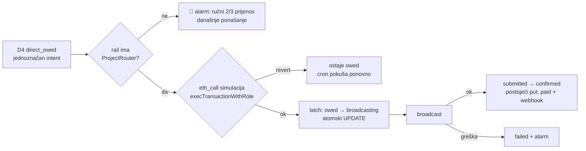

# ADR 0026 — ProjectRouter: rola na MPT Safe-u ograničena on-chain na projektne Safe-ove

- **Status:** Proposed (2026-10-16)
- **Kontekst:** MPT rail (`backend/`), MPT Safe `0x449a…af2e` (2/3), Roles modifier `0x3303…762c`
  (Zodiac Roles v2, mastercopy `0x9646…D337`)
- **Gradi na:** [0025](0025-mpt-router-umirovljen-svi-tenanti-direct.md) (§Revolut bez reference) ·
  [0018](0018-stray-payment-resolver.md) (stray resolver) ·
  [0017](0017-multi-tenant-rail.md) (rail po tenantu) ·
  [postmortem 0002](../postmortems/0002-admin-auth-bypass-percent-encoded-path.md)
- **Izvor:** [dogovoreni smjer, 16. 10. 2026.](../2026-10-16-router-ogranicen-na-projekte.md)

## Problem

ADR 0025 je skinuo router: MPT Safe nema modul, a `ROUTER_PRIVATE_KEY` je obrisan. Revolut
nakon skeniranja QR-a briše opis plaćanja, pa Monerium minta na MPT Safe. Stray resolver
uplatu ispravno veže uz intent, ali ona ostaje D4 `direct_owed` dok 2/3 vlasnika ručno ne
prebace novac. Uplata bez reference je normalan slučaj, ne iznimka (svih pet uplata 15. 10.),
a ručni prijenos kao trajno stanje i „Move IBAN" na Safe projekta su odbijeni (ADR 0025,
§Odbijeno).

Router koji smije `EURe.transfer` bilo kome (stara rola `EUReForwarder`) ne dolazi u obzir:
tko ima ključ, prazni Safe. Postmortem 0002 pokazao je koliko je to blizu.

## Odluka

**Rola `ProjectRouter` na MPT Safe-u smije samo `EURe.transfer(to, amount)`, gdje je `to`
jedan od projektnih Safe-ova koje su 2/3 vlasnika unaprijed odobrili. Ograničenje provodi
Roles modifier na lancu, ne Worker.** Rail tom rolom automatski prosljeđuje D4 uplate s
jednoznačnim intentom.

Sigurnost je u ograničenju na lancu, ne u mjestu ključa. Ključ routera živi kao Workers
secret, kao i prije ADR-a 0025. Razlika je u tome što s njim više nema puta do adrese izvan
skupa.

| Tko ima ključ / kontrolu | Što može |
|---|---|
| Router EOA (Workers secret) | `EURe.transfer` s MPT Safe-a **samo** na projektni Safe iz skupa |
| Kompromitirani Worker / Cloudflare račun | isto: novac ode u *krivi od vlastitih* projekata. Detektor odljeva to vidi, 2/3 vlasnika ispravljaju |
| Delegate MPT Safe-a (`funding-init`) | predložiti transakciju u red Safe-a; ne može je potpisati ni izvršiti |
| 2/3 vlasnika | mijenjaju skup, opozivaju rolu, gase modul |

Invarijanta iz INDEX-a („no cloud-held signing keys") ovdje je svjesno oslabljena: ključ u
oblaku postoji, ali ne može pomaknuti novac izvan skupa koji su potpisali vlasnici. To je ista
klasa štete kao lažna obavijest (ADR 0025, §Posljedice), ne krađa.

### Dozvola na lancu (`safe-tx/009`)

Jedan Safe batch, 2/3 potpis:

1. `Safe.enableModule(Roles 0x3303…)`: modul je ponovno uključen.
2. `Roles.revokeTarget(EUReForwarder, EURe | PaymentRegistry | MultiSendCallOnly)`: stara
   rola nema članova (`008`), ali su joj dozvole ostale zapisane, a modul se vraća. Brišu se
   da greška u budućem `assignRoles` ne bi vratila neograničeni `transfer` ni MultiSend.
3. `Roles.scopeTarget(ProjectRouter, EURe)`.
4. `Roles.scopeFunction(ProjectRouter, EURe, transfer(address,uint256), uvjeti, None)`:

   ```
   [0] Calldata  Matches                (root)
   [1] None      Or                      ← parametar `to`
   [2] Static    Pass                    ← parametar `amount` (bez kapice)
   [3…] Static   EqualTo projektᵢ       (djeca čvora [1])
   ```

   Za jedan projekt `[1]` je izravno `Static EqualTo`. `ExecutionOptions.None`: bez xDAI
   vrijednosti i bez DelegateCalla, pa ni MultiSend ni PaymentRegistry (`006` §1).
5. `Roles.assignRoles(novi router EOA, [ProjectRouter], [true])`.

Enumi i pravila stabla provjereni su na verificiranom izvornom kodu mastercopyja
(`Types.sol`, `Integrity.sol`, solc 0.8.21): logički čvor (`Or`) mora imati
`paramType = None`. `006` i `007` su ga slagali kao `Static`, što bi `scopeFunction` odbio s
`UnsuitableParameterType(1)`. Zajednički builder je ispravljen. Dokaz prije potpisa je
simulacija na forku (dopušteni primatelj prolazi, ostali revert), opisana u `009`.

**Bez kapice na iznos** (Matija, ADR 0019 §Odbijeno): ograničenje primatelja je dovoljno
jer je najgori ishod premještaj među vlastitim projektima.

### Novi projekt: prijedlog u redu Safe-a

`scopeFunction` **prepisuje** cijelo stablo, pa novi projekt znači novi `scopeFunction` s
punim popisom. Izvor popisa je lanac: zadnji događaj `ScopeFunction(ProjectRouter, EURe,
transfer)` na Roles modifieru, ne repo ni D1.

`tools/funding/funding-init.mjs` (nakon Safe-a projekta i Monerium linka):

1. pročita trenutni skup s lanca i doda novi Safe,
2. složi `scopeFunction` s punim popisom,
3. predloži transakciju u red MPT Safe-a preko Safe Transaction Servicea, potpisano ključem
   **delegatea**,
4. vlasnici potvrde u app.safe.global ili Safe mobilnoj aplikaciji („Needs confirmation").
   U dekodiranom prikazu provjeravaju da su stari projekti još na popisu.

Delegate jednokratno registrira jedan vlasnik. Njegov ključ živi lokalno kod Matije uz
`funding-init` (`.env.<env>`, gitignored). Admin gumb „Novi projekt" u Workeru je kasnija
odluka.

### Rail



- Novo stanje nije potrebno. Novi prijelaz `owed —router_claim→ broadcasting` zauzme red
  **prije** broadcasta. Tako webhook i cron ne mogu isti dug platiti dvaput. Dalje vrijede
  postojeći `broadcast_ok` / `broadcast_failed` i `receipt_*`.
- Simulacija ide **prije** latcha. Revert (projekt još nije u roli, prijedlog čeka 2/3,
  nedovoljan saldo) ostavlja red `owed`, a cron ga pokušava svaka 2 minute. Nakon potvrde
  prijedloga uplata se proslijedi sama.
- Greška nakon latcha je `failed` s alarmom, kao kod starog forwarda. Ne vraća se u `owed`,
  jer nejasna greška RPC-a može značiti da je tx ipak poslan, pa bi ponovni pokušaj platio
  dvaput.
- Rail bez role (nema `PROJECT_ROUTER_*` ili retka s ključem) ponaša se točno kao danas: D4 i
  Telegram. Kad rola postoji, alarm 🧾 kaže da vlasnici **ne** prenose ručno, jer bi
  prijenos koji detektor još nije vidio i router platili isti dug dvaput.
- Detektor odljeva: tx routera ima `tx_hash` u `monerium_forwards`, pa je `known`. Ako Worker
  padne između broadcasta i zapisa, red je `broadcasting` bez hasha, a detektor javlja ⚠️
  `role_unhashed`, ne 🚨.
- Postojeći `direct_owed` redovi plaćaju se automatski čim rola proradi (produkcija: #187,
  1 € Lukavec). Tko ih ne želi tako zatvoriti, mora ih zatvoriti prije deploya.

Konfiguracija:

| Rail | Ključ | Roles / role key |
|---|---|---|
| `italk` (legacy) | Workers secret `PROJECT_ROUTER_PRIVATE_KEY` | `ROLES_MODIFIER_ADDRESS`, `PROJECT_ROUTER_ROLE_KEY` (`wrangler.toml`) |
| tenant u `tenant_rail` (`mode = 'direct'`) | `router_key_enc` | `roles_modifier`, `role_key` |

Stari `ROUTER_PRIVATE_KEY` / `ROLE_KEY` (`EUReForwarder`) se ne vraćaju. Ključ je nov
(`safe-tx/000`, generira Matija offline), a stari EOA `0xd612…54CB` ostaje bez role.

## Odbijeno

- **Android telefon kao router bez ograničenja na lancu.** Ukraden ili rootan telefon prazni
  Safe jednako kao ukraden secret. Telefon mora pitati Worker kamo slati, a kompromitirani
  Worker ga navodi. Dok je telefon ugašen, uplate čekaju. Može doći **kasnije** kao zaštita
  od krivog rutiranja među vlastitim projektima.
- **Kapica na iznos ili allowance** (ADR 0019, §Odbijeno): fragmentira legitimne uplate.
- **Popis primatelja u D1 ili repou kao izvor istine:** popis koji rail misli da vrijedi i
  popis koji Roles provodi bi se razišli. Lanac je jedini izvor.

## Otvoreno

- **Per-tenant:** svaki tenant s vlastitim glavnim Safe-om treba svoju rolu i svoj Roles
  modifier (uzor `007`, bez kapice). Za sada `italk` i `italk-sandbox`.
- **Veličina `Or` stabla:** `parent` je `uint8` (najviše 256 čvorova), a stablo se sprema kao
  SSTORE2 blob, pa plin raste linearno s brojem projekata. Do ~50 projekata to nije
  problem. Za više: custom condition s registry ugovorom kojim upravlja 2/3.
- **Delegate ključ u Workeru** za admin gumb „Novi projekt".

## Redoslijed

1. Ovaj ADR (Proposed → Accepted nakon Chiada).
2. `safe-tx/009` generator, enumi provjereni, simulacija na forku.
3. `tools/funding`: korak s delegateom.
4. Rail: latch, simulacija, cron, testovi.
5. Chiado (`italk-sandbox`, Safe 1.3.0): Roles proxy, batch 009, prijedlog delegatea, D4
   uplata → automatski forward. Redovi #96 i #97 su prirodni test.
6. Produkcija: novi router ključ kao Workers secret, batch 009 (2/3), deploy.

## Implementacija

| Korak | Stanje |
|---|---|
| 1. ADR | 📝 PR `feat/adr0026-project-router` |
| 2. `safe-tx/009` | ✅ generator + `009-simulate-fork.mjs`; Gnosis fork 13/13, Chiado fork 11/11 |
| 3. `funding-init` + delegate | ✅ `router-scope.mjs` (korak 6), `--setup` predlaže cijeli 009 kao MultiSend; `deploy-roles.mjs` |
| 4. Rail | ✅ `router_claim`, `routeOwed`, cron `routeAllOwedForwards`, 16 testova, compat-check prolazi |
| 5. Chiado E2E | 🟡 Kod mergan (#112) i deployan 16. 10. (`246b390b`). Roles proxy, biblioteke, router `0xD922…6759` (0,01 xDAI) i rail `italk-sandbox` (`roles_modifier`, `role_key`, router ključ, verify OK) gotovi. Čeka registraciju delegatea (vlasnički potpis), prijedlog `router-scope --setup` i 2/3 potvrdu |
| 6. Produkcija | ⏳ |

### Chiado: Roles v2 bez biblioteka (16. 10. 2026.)

Mastercopy `0x9646…D337` na Chiadu postoji, ali njegove vanjske biblioteke **Packer**
(`0x61C5…8a8C`) i **Integrity** (`0x6a6A…1049`) nisu bile deployane, pa je svaki
`scopeFunction` revertao („call to non-contract address"). Na Gnosisu su obje deployane
kroz singleton factory `0xce00…cf9f` (CREATE2). `tools/funding/deploy-roles.mjs` ponovi
točan calldata iz Gnosis tx-a i provjeri da je hash koda isti kao na Gnosisu:
Packer tx `0xd6ca…b508`, Integrity tx `0xeb7e…d5a`. Roles proxy za glavni Safe
`italk-sandbox`: `0x8E926f20eAe8bDCED7Bb7c14F006aEC4975E1532` (blok 23538972).

### Delegate: Safe sučelje traži Safe Pro (16. 10. 2026.)

app.safe.global → Settings → Setup → Proposers za dodavanje novog proposera traži plaćeni
**Safe Pro** („Adding proposers requires Safe Pro"; postojeći ostaju aktivni). Isti učinak
daje API Safe Transaction Servicea bez Pro: `POST https://api.safe.global/tx-service/<chi|gno>/api/v2/delegates/`
s poljima `safe`, `delegate`, `delegator`, `signature`, `label`. Potpis je EIP-712 vlasnika:
domena `{name: "Safe Transaction Service", version: "1.0", chainId}`, tip
`Delegate(address delegateAddress, uint256 totp)`, `totp = floor(unix / 3600)` (vrijedi
sat vremena). Stari hostovi `safe-transaction-*.safe.global` vraćaju 308 na
`api.safe.global/tx-service/<kratica>`. Delegate za `italk-sandbox`:
`0xC32230939b690DDFA98100F04d20467E9D48d34E` (ključ u `tools/funding/.env.sandbox`).
Bez registracije servis odbija prijedlog s 422 „Sender … is not an owner or delegate".

