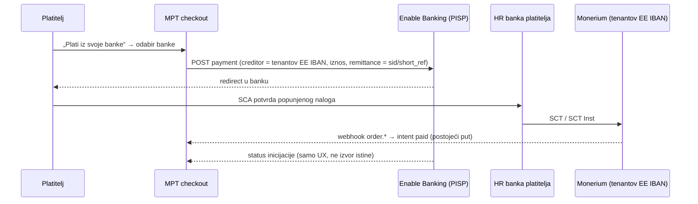

# ADR 0031 — PSD2 PIS: popunjen nalog iz HR banke na tenantov Monerium IBAN

- **Status:** Proposed (2026-10-29), skica. Bez koda dok Enable Banking ne odgovori na pitanja
  ispod i dok se ne napravi test T2.
- **Kontekst:** MPT checkout, Monerium rail (`EE…` IBAN po tenantu), `backend/src/providers/`
  (Enable Banking AIS aplikacija već postoji)
- **Gradi na:** [0016](0016-tenant-payout-whitelist.md) (fail-closed whitelist) ·
  [0018](0018-stray-payment-resolver.md) · [0020](0020-hr-iban-listener-bez-minta.md) ·
  [0028](0028-kratka-referenca-intenta.md)
- **Istraživanje:** [`docs/research/2026-10-29-sepa-prefill/`](../research/2026-10-29-sepa-prefill/README.md)

## Problem

HR bankovne aplikacije čitaju HUB3, a HUB3 s `EE…` IBAN-om ne puštaju (PBZ, HPB, RBA, Aircash;
test 2026-10-11). Revolut čita EPC QR, ali je skener spor i ispušta referencu. Deep link koji
puni SEPA nalog na proizvoljan IBAN ne postoji (`payto:` bez bankovne podrške; Revolut nema
`iban=`). Wero i SRTP u Hrvatskoj nisu živi.

PSD2 PIS je jedini nađeni mehanizam u kojem **HR banka sama prikaže popunjen nalog** (IBAN,
iznos, opis s referencom intenta), platitelj ga potvrdi SCA-om, a novac ide izravno s
njegovog računa na tenantov IBAN. PISP novac ne dira.

## Prijedlog

1. **Nova opcija na checkoutu** uz EPC QR i HUB3: „Plati iz svoje banke“, popis banaka iz
   Enable Banking ASPSP liste (HR: Zaba, PBZ, Erste, RBA; OTP nije podržan).
2. **Beneficiar je samo tenantov registrirani Monerium IBAN** iz D1, nikad proizvoljan unos.
   Isto načelo kao on-chain whitelist (ADR 0016, 0026).
3. **Izvor istine ostaje Monerium webhook.** Status PIS inicijacije služi samo za UX („banka
   je prihvatila nalog“). Na `paid` se ne vjeruje.
4. **Referenca** ide u `remittance_information` kao danas (`sid` + short_ref). Iznos nikad ne
   nosi identitet.
5. **Skrbništvo:** novac ide s platiteljevog računa izravno na tenantov IBAN. MPT/ITalk ga ne
   drži, pa nema promjene u Modu 1.

## Otvorena pitanja (blokiraju odluku)

1. Enable Banking: je li PIS dostupan na našoj aplikaciji, pod kojim ugovorom i po kojoj cijeni?
2. Smije li `creditor_account` biti `EE…` (LHV) i mora li biti unaprijed registriran?
   Token.io npr. traži odredišta dodana na dashboardu.
3. Ide li SCT Inst preko HR ASPSP API-ja? Ako ne, uplata stiže T+0/T+1, a to je lošije od
   Revoluta.
4. Stiže li `remittance_information` netaknut do Moneriuma (`memo`)?
5. UX: Erste ne podržava app-switch za open banking autentikaciju, pa na mobitelu ide web
   prijava. Je li to prihvatljivo?
6. Postoji li jeftiniji put: **ako T2 pokaže da HR banke puštaju EPC QR s `EE…` IBAN-om**, PIS
   nije potreban za prefill.

## Alternative (iz istraživanja)

- **HR IBAN + HUB3 + bank-push-gateway** (ADR 0020): radi danas za sve HR aplikacije, ali bez
  minta i uz tenantov HR račun. *Napomena:* ADR 0020 t. 4.3 još navodi „jedinstveni iznos po
  otvorenom intentu“. To je u sukobu s odlukom od 19. 10. 2026. (CLAUDE.md, ADR 0028) i treba
  ga izbaciti iz ADR-a 0020 prije prihvaćanja.
- **Virtualni IBAN po intentu** (Swan, Stripe): identitet bez reference, ali IBAN nije HR,
  pa ne pomaže HR aplikacijama. Uz to je potreban drugi pružatelj i sweep do EURe.
- **Wero / SRTP:** nisu živi u HR. Pratiti.
