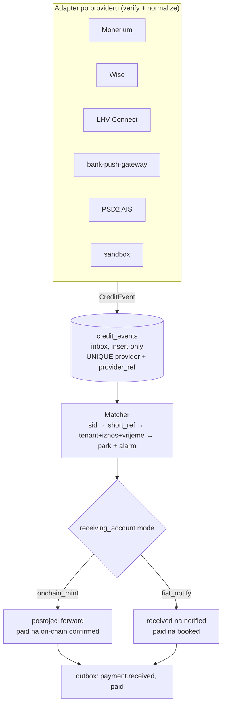

# ADR 0032 — Više izvora priljeva: jedan događaj, zajedničko uparivanje, adapter po provideru

- **Status:** Proposed (2026-11-14)
- **Kontekst:** MPT rail (`backend/`): `monerium/webhookHandler.ts`, `monerium/strayResolver.ts`,
  `intents/` (state machine, `confirm.ts`, outbox), `sandbox/simulate.ts`,
  `providers/` (Enable Banking / GoCardless AIS)
- **Gradi na:** [0017](0017-multi-tenant-rail.md) (rail po tenantu) ·
  [0018](0018-stray-payment-resolver.md) (uparivanje bez reference) ·
  [0020](0020-hr-iban-listener-bez-minta.md) (HR IBAN, bank-push-gateway, bez minta) ·
  [0024](0024-samoposluzni-sandbox-i-return-url.md) (sandbox kroz pravi settle put) ·
  [0028](0028-kratka-referenca-intenta.md) (kratka referenca)
- **Istraživanje:** `pinkainc/open-banking/docs/research/2026-10-23-lhv-connect-clients-and-feasibility.md`
  (tko koristi LHV Connect), lokalni mirror LHV dokumentacije `pinkainc/docs.lhv-connect`
  (samo lokalno, ne objavljuje se), docs.wise.com (pročitano 2026-11-14)

## Problem

Tenant danas može biti samo Monerium račun. Monerium daje dvije stvari odjednom: detekciju SEPA
uplate (webhook s opisom plaćanja) i mint EURe na tenantov Safe. Matcher, stray resolver,
stanja intenta i merchant webhookovi rade za bilo koju SEPA uplatu, ali su kroz kod vezani na
Monerium:

- uparivanje živi u `monerium/webhookHandler.ts` i `monerium/strayResolver.ts`;
- „intent ima uplatu” se čita iz stupca `payment_intents.monerium_order_id`
  (`intents/db.ts`, guarded UPDATE `... AND monerium_order_id IS NULL`);
- dedup je po Monerium `webhookId`.

Ako bilo koji drugi pružatelj javlja da je na račun stigla SEPA ili SEPA Instant uplata, MPT
može raditi isti posao za njegove klijente. Kandidati su Wise, LHV Connect (za tenanta ili MPT
koji ima vlastiti LHV račun), bank-push-gateway (ADR 0020) i PSD2 AIS.

## Što je istraživanje pokazalo (ispravak razgovora od 2026-11-14)

U prvom odgovoru napisao sam da Wise nije na LHV Connectu. **To je bilo krivo.** Istraživanje
od 2026-10-23 navodi javno potvrđene klijente LHV Connecta: **Wise** (prvi klijent bankovnih
usluga, pristupio 2011., uključen 2014.), **Coinbase** (od 2014., virtualni IBAN-i, TIPS),
**Blockchain.com**, Bitstamp, Airwallex, Currencycloud, TrueLayer, Paysafe, Trustly, Monese,
TransferGo, Railsr, Lightyear i drugi. **Monerium** ne spominje nijedan javni izvor, ali njegovi
`EE…` IBAN-i nose LHV-ov BIC. Koji IBAN koji provider izdaje (i kako ga prepoznati: `EE..7777` =
LHV VIBAN, `BE..967` = Wise Europe SA) vodi katalog
[`docs/reference/lhv-connect-provideri-iban.md`](../reference/lhv-connect-provideri-iban.md).

Ipak, to ne znači da postoji jedan adapter za sve njih:

1. **LHV webhookove dobiva LHV-ov klijent, ne njegovi korisnici.** Kad uplata stigne na Wise ili
   Monerium IBAN, LHV obavijesti Wise ili Monerium. MPT vidi samo ono što Wise ili Monerium
   izlože svojim korisnicima kroz vlastiti API. Zato je svaki provider zaseban adapter.
2. **Wise za EEA danas izdaje belgijske IBAN-e preko Wise Europe SA.** To je platna institucija
   koju je ovlastila Narodna banka Belgije (reg. 0713.629.988), a virtualni IBAN-i su vezani uz
   BIC Wise Europe (`TRWIBEBB…`). U razgovoru smo je zvali „EMI”, ali Wiseova stranica o
   regulaciji kaže *Payment Institution*. Ide li EUR priljev na te IBAN-e još kroz LHV, nije
   potvrđeno i za ovaj ADR nije bitno.
3. **Coinbase i Blockchain.com nisu kandidati za tenanta.** Njihovi virtualni IBAN-i služe za
   uplatu na vlastiti račun korisnika na burzi, a ne za primanje uplata trećih s opisom koje bi
   API javio merchantu.
4. **LHV Connect adapter ima smisla samo za vlastiti LHV račun.** ITalk je 2026-10-30 zatražio
   LHV sandbox. Emulator `pinkainc/open-banking` (kompatibilan s LHV Connect API-jem) može biti
   test double za taj adapter.

### Formati signala po provideru

| Provider | Događaj | Opis plaćanja u događaju? | Autentikacija | Napomena |
|---|---|---|---|---|
| Monerium | `order.created` / `order.updated` (`state=processed`) | da (`memo`) | postojeća provjera u `monerium/webhook.ts` | forward samo na `processed`, nikad na `created` |
| Wise | `account-details-payment#state-change` (`PROCESSING` → `COMPLETED` / `CANCELLED` / `REFUNDED`) | **ne**: iznos `data.transfer.amount`, valuta `data.transfer.currency`, platitelj `data.sender.name`, `data.sender.account_number`; ID `data.transfer.id` | `X-Signature-SHA256`, RSA-SHA256 nad tijelom, Wiseov javni ključ; dedup `X-Delivery-Id` | opis treba dohvatiti naknadnim pozivom (endpoint još nije potvrđen); `balances#credit` je deprecated, `balances#update` ne nosi opis; 2xx u 5 s, do 25 ponovnih pokušaja kroz 2 tjedna; redoslijed nije zajamčen (`data.occurred_at`) |
| LHV Connect | webhook `GENERAL_WEBHOOK` = „nova poruka u inboxu” (`messageType`, `messageResponseId`, opcionalni `metadata`) | ne izravno: poruka se dohvaća s `GET /messages/next` ili po ID-u; priljev je ISO 20022 `camt.054` (`RmtInf`) | `X-LHV-HMAC`, HMAC-SHA256 nad sirovim tijelom, dijeljena tajna; uz to mTLS za API | provjeriti `clientCode`, `clientCountry` i `eventTimestamp`; nepročitane poruke istječu nakon 5 dana |
| bank-push-gateway | `account.credit` | ovisi o banci (gateway faza 0) | HMAC po pretplatniku | push je okidač, a izvod izvor istine (ADR 0020) |
| PSD2 AIS | polling transakcija (`providers/`) | da (`remittanceInfo`) | OAuth sesija | ~4 čitanja dnevno, služi za usklađivanje |
| sandbox | simulirana uplata (ADR 0024) | da | `sk_test_` | dokaz da apstrakcija radi |

Wise traži i odluku o modelu pristupa: pretplata na razini aplikacije (Wise Platform, client
credentials) ili na razini profila (`USER_TOKEN` tenanta). Iz dokumentacije nije jasno vrijedi li
običan Business API token za webhook pretplatu. Treba pitati Wise.

## Odluka (prijedlog)

Apstrahira se **događaj priljeva**, a ne provider. Provider postaje tanak adapter, a uparivanje,
stanja i webhookovi postaju zajednički.



### 1. `CreditEvent`

```ts
interface CreditEvent {
  provider: 'monerium' | 'wise' | 'lhv' | 'bank_push' | 'ais' | 'sandbox';
  providerRef: string;            // idempotencija: Monerium order id, Wise transfer id, camt.054 NtryRef…
  receivingIban: string;          // → receiving_account → tenant
  amountCents: number;
  currency: 'EUR';
  remittance?: string;            // nositelj sid-a / short_ref-a
  endToEndId?: string;
  debtorName?: string;
  debtorAccount?: string;         // IBAN ili account_number, ovisno o provideru
  scheme?: 'sepa' | 'sepa_inst';
  finality: 'notified' | 'booked' | 'onchain_confirmed';
  occurredAt: string;
  raw: unknown;
}
```

Adapter smije emitirati događaj tek kad ima opis plaćanja ili kad sigurno zna da ga provider
ne prenosi. Za Wise to znači da najprije dohvati detalje transfera, pa tek onda normalizira.

### 2. `finality` pripada događaju, ne provideru

Isti provider šalje događaje različite pouzdanosti. Mapiranje:

- Monerium `order.created` → `notified`; `order.updated` + `processed` → `booked`; forward i
  potvrda na lancu → `onchain_confirmed`;
- Wise `PROCESSING` → `notified`; `COMPLETED` → `booked`; `CANCELLED` ili `REFUNDED` → povrat
  (vidi otvorena pitanja);
- gateway push → `notified`; izvod ili AIS → `booked`.

Pravilo „nikad forward na `order.created`” tako postaje opće pravilo: na `notified` nema
pomicanja novca ni stanja `paid`, samo `received` za checkout.

### 3. Tenant ima N `receiving_accounts`

Tablica `receiving_accounts(id, tenant_id, provider, iban, mode, credentials_enc, label, active)`,
gdje je `mode ∈ {onchain_mint, fiat_notify}`. Credentials (Wise token, LHV certifikat ili tajna,
gateway HMAC) kriptiraju se kao `router_key_enc`. Tako se zatvara otvoreno pitanje iz ADR 0020:
isti tenant može imati HR IBAN za HUB3 i `EE…` za Revolut, a checkout bira kod po računu.

Credentials su uvijek **tenantovi**. MPT ne drži tuđi novac ni u jednom `fiat_notify` računu, što
je isti model kao merchant-direct od 2026-09-28 (`docs/compliance/`).

### 4. Veza intent ↔ uplata ide kroz tablicu

Uvodi se `intent_settlements(intent_id, credit_event_id, matched_by, created_at)`. State machine
(`intents/intentStates.ts`) se ne mijenja jer su prijelazi već neovisni o provideru. Mijenja se
samo guard: umjesto `monerium_order_id IS NULL` provjerava se nepostojanje settlementa.
`monerium_order_id` ostaje i puni se za Monerium događaje radi kompatibilnosti (regresijski
ugovor, `docs/testing.md`).

### 5. Jedan dedup, jedan matcher

`UNIQUE(provider, provider_ref)` na inboxu zamjenjuje dedup po provideru. Push i polling istog
providera (LHV webhook i `messages/next`, gateway push i AIS) pune isti inbox, pa se ista uplata
ne može upariti dvaput.

Matcher redom pokušava sid, pa `short_ref` (ADR 0028), pa tenant + iznos + vrijeme (ADR 0018,
otvoreni intenti prije isteklih), a sve ostalo parkira uz alarm. **Jedinstveni iznos po intentu
ne smije postojati** (odluka od 19. 10. 2026.); točku 4.3 ADR-a 0020 treba izbaciti.

### 6. Merchant webhookovi ostaju isti

`payment.received` i `paid` dobivaju polja `source` (provider) i `settlement` (mode). Merchant ne
mora znati odakle je signal došao.

### 7. Ruta po provideru

Svaki provider ima svoju dolaznu rutu, u istom obliku kao Monerium:
`POST /api/<provider>/webhook/t/:tenantId` (`/api/monerium/…` već postoji, `/api/swan/…`,
`/api/wise/…`, …). Ruta određuje adapter, a adapter provjerava autentičnost na svoj način.
Nema univerzalne rute koja pogađa providera iz tijela ili headera: tada bi pošiljatelj birao
kojom se provjerom provjerava njegov zahtjev. Tenant mora imati aktivan `receiving_account` tog
providera, inače 404 (kao danas `unknown_tenant`). Od rute nadalje sve je zajedničko:
`CreditEvent` → inbox → matcher.

## Redoslijed

1. **Refactor bez promjene ponašanja:** `credit_events` + `CreditEvent`; Monerium webhook piše u
   inbox; matcher se izvlači iz `monerium/webhookHandler.ts` i `strayResolver.ts`.
   `scripts/compat-check.sh` mora proći bez oznake `behavior-change`.
2. `receiving_accounts` i `intent_settlements`; postojeći tenanti dobiju po jedan
   `onchain_mint` račun (migracija iz `tenants`).
3. **Sandbox kao adapter:** prvi dokaz da cijeli put inbox → matcher → settlement radi bez
   Monerium koda.
4. **bank-push-gateway adapter** (ADR 0020 faza 3): prvi `fiat_notify`, a gateway je naš.
5. **Wise adapter:** nakon odgovora Wisea o modelu pristupa i potvrde endpointa za opis plaćanja.
6. **LHV Connect adapter:** kad ITalk ili tenant dobije LHV račun, a prije toga razvoj protiv
   emulatora `pinkainc/open-banking`.

Redoslijed providera i vrata za sandbox test („prvo sandbox, pa KYB”):
[`docs/plans/provideri-priljeva-sandbox-prvo.md`](../plans/provideri-priljeva-sandbox-prvo.md).

## Odbačeno

- **Jedan „LHV adapter” za sve LHV klijente:** LHV obavještava Wise ili Monerium, ne njihove
  korisnike. Nema zajedničkog API-ja s naše strane.
- **Apstrakcija na razini providera** (`interface Provider { handleWebhook(); markPaid(); }`):
  uparivanje i stanja bi se kopirali u svaki provider. Upravo je to danas problem s Moneriumom.
- **Coinbase i Blockchain.com kao tenant provideri:** virtualni IBAN služi za vlastitu uplatu na
  burzu, a ne za primanje uplata s opisom.

## Otvorena pitanja

- **Wise:** koji endpoint vraća opis plaćanja za `data.transfer.id`? Vrijedi li Business API
  token za profilnu webhook pretplatu ili je potreban Wise Platform? Prenosi li Wise opis SEPA
  uplate u cijelosti (sid, short_ref)? Javlja li se SEPA Instant odvojeno od obične uplate?
- **Povrati:** kako se Wise `REFUNDED` i LHV povrat (camt.054 debit) odražavaju na intent koji je
  već `paid`? Danas tog prijelaza nema.
- **LHV:** daje li LHV Connect `Client-Code` model (service provider za krajnje korisnike) i
  tenantima koji nisu MPT, ili samo izravnim klijentima?
- **Kompliance:** je li dojava za `fiat_notify` tenanta tehnička usluga (PSD2 čl. 3(j)) i za Wise
  i za LHV, kao i za HR IBAN u ADR 0020?

## Izvori

- `pinkainc/open-banking/docs/research/2026-10-23-lhv-connect-clients-and-feasibility.md`
- LHV webhookovi (mirror): `docs/gitbook/connect/services/webhooks/{webhook-security,webhook-metadata}.md`
- https://docs.wise.com/api-reference/webhook-event/eventaccountdetailspaymentstatechange
- https://docs.wise.com/guides/product/accounts/mca-webhooks
- https://docs.wise.com/api-reference/balance/eventbalancesupdate
- https://docs.wise.com/api-reference/legacy/balance/eventbalancescredit (deprecated)
- https://docs.wise.com/guides/developer/webhooks/event-handling
- https://wise.com/help/articles/2932693/how-is-Wise-regulated-in-each-country
- https://wise.com/terms-of-use-business
