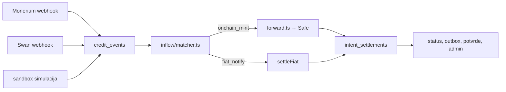

# Plan: zatvaranje Swan / ADR 0032 i admin v2

## Zašto

Admin v2 je mergan i deployan (#156–#169), a Swan daje `paid` u sandboxu kroz pravi put. Ispod
toga ostaje dug iz ADR 0032: guardovi još gledaju `payment_intents.monerium_order_id`, fiat
namira glumi Monerium order (`swan_<txId>` u `monerium_orders`), a Monerium ne prolazi kroz
zajednički matcher. Ovaj lanac to zatvara, uz sitne stavke (Flutter, Swan secret i IBAN,
Crošulja, v1 admin) koje traže Matijinu odluku ili ruku.

Izvori: [ADR 0032](../../decisions/0032-visestruki-izvori-priljeva.md),
[Swan istraživanje](../../research/provideri/swan.md),
[admin v2](../../2026-11-18-admin-v2.md), [stanja](../../state-machines.md).

## Arhitektura (cilj)

Danas: Monerium ide `webhookHandler → forward.ts/strayResolver` i samo se zapisuje u inbox;
fiat piše sintetski `monerium_orders` red; čitatelji gledaju `monerium_order_id`.

## Tvrdi uvjeti (svaka sesija)

- Regresijski ugovor: `scripts/compat-check.sh` zelen, ili PR s oznakom `behavior-change` i
  objašnjenim svakim starim testom. Stari `expect`-ovi se ne mijenjaju.
- Rad u git worktreeu, kroz PR + CI; `main` ima rulesete.
- Put novca (forward, settlement, matcher) se ne deploya bez Matijine potvrde ako mijenja ponašanje.
- Tajne (Swan client/webhook secret, `sk_`) unosi Matija kroz admin UI, nikad agent.
- Produkcijski D1 ima `PRAGMA foreign_keys = 1`: nova tablica s FK ide u `sweepExpiredSandboxTenants`.
- Iznos uplate nikad ne nosi identitet (CLAUDE.md).

## Sesije

| # | Faza | Paket | Odluke | Gotovo kad |
| --- | --- | --- | --- | --- |
| S1 | F0 | Mjerenje Monerium inboxa u prodi + guardovi na `intent_settlements` | 100–199 | brojke inboxa u `research/`; 0 pojavljivanja `monerium_order_id IS [NOT] NULL` u guardovima; test usklađenosti; `npm test` ≥ 889 + novi, compat-check zelen bez `behavior-change`; mergano i deployano |
| S2 | F1 | Čitatelji fiat namire iz `intent_settlements` + `credit_events` (sintetski red još postoji) | 200–299 | test „isti izlaz sa i bez sintetskog reda” za Swan i sandbox; compat-check zelen; mergano i deployano |
| S3 | F1 | **Vrata:** `settleFiat` bez sintetskog ordera/forwarda | 300–399 | Matija potvrdio; nijedan novi `monerium_orders` red za Swan uplatu na prodi (D1 upit); živa Swan sandbox uplata `paid` |
| S4 | F2 | **Vrata:** Monerium kroz `inflow/matcher.ts` | 400–499 | replay svih Monerium scenarija zelen; compat-check zelen; nakon Matijine potvrde deploy i živa sandbox uplata `paid` |
| S5 | F3 | Flutter fiat tekstovi | 500–599 | `flutter test` zelen s fiat slučajem; `flutter analyze` bez novih upozorenja |
| S6 | F4 | Swan: uređivanje IBAN-a/secreta u v2 + format secreta | 600–699 | PUT ruta + UI + test; istraživanje secreta zapisano; **vrata:** Matija upisao IBAN i secret, adapter odbija krivi header (živo) |
| S7 | F5 | Crošulja provjera koda + odluke o CRO-2026-0210 i v1 | 700–799 | nalaz u `research/`; odgovori Matije upisani u `decisions.md` |
| S8 | F5 | Uklanjanje v1 admina (samo ako S7 kaže da) | 800–899 | PR `behavior-change` s popisom starih testova; v1 rute vraćaju redirect na v2 ili 404 po odluci |

## Procjena, vrata, paralelno, rizik

- 8 sesija; S8 otpada ako Matija ne gasi v1.
- Vrata: S3 (prestanak pisanja sintetskog reda na prodi), S4 (deploy matchera na putu novca),
  S6 (tajne), S7 (odluke), Swan produkcija izvan lanca.
- Paralelno: S5 (samo `lib/`, `test/`) može ići uz bilo koju; S7 čitanje Crošulje ne dira ovaj repo.
  S1–S4 su strogo linearni (dijele `intents/`, `inflow/`, `monerium/`).
- Najrizičniji: **S4** (mijenja tko odlučuje o uparivanju svake Monerium uplate; dvostruka
  isplata ili propušten stray su novac) i **S3** (stari redovi i čitatelji koji ih očekuju).
  Zato S1 prvo mjeri radi li inbox uopće u prodi; ako Monerium događaji nisu vezani, S4 se
  ne pokreće dok se to ne popravi.

## Gdje smo

S0 (2026-11-20): plan napisan, koda nema. `main` = 201a918, backend `npm test` 889 zelenih.
