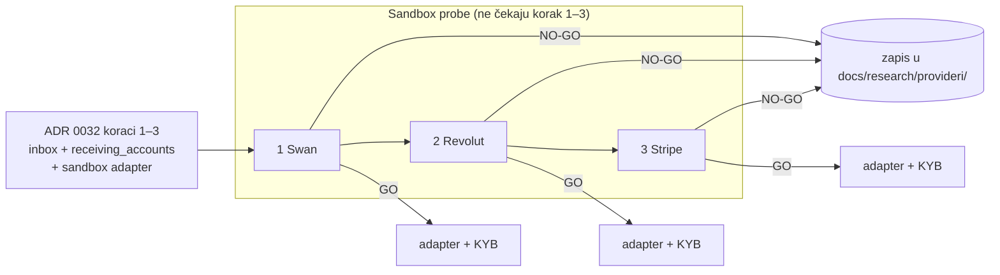

# Provideri priljeva: prvo sandbox, pa KYB

- **Stanje:** 2026-11-17, prijedlog redoslijeda
- **Služi:** [ADR 0032](../decisions/0032-visestruki-izvori-priljeva.md), koraci 4–6 (adapter po provideru)
- **Ulazi:** [katalog LHV/IBAN](../reference/lhv-connect-provideri-iban.md) (2026-11-16),
  [matrica B](../research/2026-10-29-sepa-prefill/02-strana-primatelja.md) (2026-10-29),
  provjera sandboxa iz javne dokumentacije (2026-11-17, izvori na dnu)

## Pravilo

Za svakog providera prvo otvaramo **sandbox** i u njemu radimo cijeli put, kao što danas radi
Monerium sandbox: gumb „Simuliraj SEPA uplatu” na checkoutu (`backend/src/monerium/sandboxFund.ts`)
pošalje uplatu s referencom intenta, a sve dalje je pravi put (webhook → uparivanje → `paid`).

- **Sandbox prođe** → idemo u produkcijski KYB/KYB tenanta, a adapter je već napisan i testiran.
- **Sandbox padne** → zapisujemo zašto i stajemo. KYB ne otvaramo. Zapis ostaje u repou da se
  isti provider ne istražuje dvaput.

Zapis po provideru: `docs/research/provideri/<provider>.md` (šablon dolje). Stvarni payloadi
webhookova iz sandboxa spremaju se kao fixture (`backend/test/fixtures/<provider>/`) i postaju
testovi adaptera.

## Vrata (sandbox test)

Provider prolazi kad su ispunjena sva vrata označena **obavezno**.

| # | Vrata | Obavezno | Zašto |
|---|---|---|---|
| G1 | Sandbox se otvara samoposlužno, bez prodajnog poziva i ugovora | da | inače ne možemo „probati prije KYB-a” |
| G2 | U sandboxu se može simulirati **dolazna** SEPA uplata na naš račun ili vIBAN, s našim tekstom opisa | da | bez toga nema analoga gumbu „Simuliraj SEPA uplatu” |
| G3 | Webhook stigne i potpis se može provjeriti (HMAC/RSA/mTLS) | da | adapter = verify + normalize |
| G4 | Opis plaćanja (sid / short_ref) je u webhooku ili se dohvati jednim pozivom po ID-u, **ili** identitet nosi vIBAN | da | matcher (ADR 0018, 0028) |
| G5 | Ime i IBAN platitelja u događaju | ne | stray resolver, potvrde (ADR 0022) |
| G6 | SEPA Instant se razlikuje od obične (`scheme`) i stiže u sekundama | ne | checkout UX |
| G7 | Produkcija prima hrvatsku tvrtku (ITalk d.o.o. / HR tenant) | da | inače KYB nema smisla; provjerava se iz dokumentacije prije sandboxa |
| G8 | Račun je **tenantov**, MPT drži samo pristup za čitanje/dojavu | da | Mod 1, nema skrbništva (`docs/compliance/`) |

## Prioritetna lista

| # | Provider | Zašto ovdje | G1 samoposlužni sandbox | G2 simulacija dolazne uplate | G7 HR tvrtka | Prvi korak |
|---|---|---|---|---|---|---|
| **1** | **Swan** (FR EMI, BaaS) — **sandbox GO 2026-11-17**, [zapis](../research/provideri/swan.md) | Jedini kandidat s **neograničenim vIBAN-ima po računu**: vIBAN po intentu rješava Revolutovo brisanje reference bez ikakvog trika s iznosom. Najveća nova vrijednost. | da („sandbox is open”) | da: Event Simulator u dashboardu i Testing API `simulateIncomingSepaCreditTransferReception`, i na vIBAN | Hrvatska je na popisu (samo računi, bez kartica); identifikacijske razine za HR nisu objavljene ⚠️ | otvoriti sandbox, simulirati uplatu na vIBAN, uhvatiti webhook |
| **2** | **Revolut Business** | Mnogo HR tvrtki ga već ima, pa tenant često ne treba novi KYB. Webhooks v2 s potpisom. | da (`sandbox-business.revolut.com/signup`) | djelomično: `POST /sandbox/topup` puni račun, ali nije potvrđeno nosi li **referencu i platitelja** ⚠️; to je ključno pitanje | da (HR na popisu); API traži plan Grow ili viši ⚠️ | sandbox + topup + vidjeti payload `TransactionCreated` |
| **3** | **Stripe** (bank transfer, `eu_bank_transfer`) | Test mode je odmah dostupan; `fund_cash_balance` prima polje `reference` za test uparivanja. vIBAN po kupcu (ne po intentu). | da (test mode) | da, s referencom | Stripe radi u HR ⚠️ (provjeriti dostupnost `eu_bank_transfer` za HR račun); naknada ⚠️ | test mode + `fund_cash_balance` + webhook `cash_balance.funds_available` |
| **4** | **Wise Business** | `BE..967` IBAN, tenanti ga imaju. Ali webhook nema opis, a model pristupa (Business token ili Wise Platform) je otvoren (ADR 0032). | djelomično: sandbox postoji (`wise-sandbox.com`), samoposlužni business profil nije potvrđen ⚠️ | `simulation/balance/topup` (bez opisa?) i Platform `swift-in`; SEPA s opisom ⚠️ | da | prvo odgovor Wisea na pitanja iz ADR 0032, pa sandbox |
| **5** | **bunq Business** | Callbacks s opisom, IBAN NL/BE. | da (`public-api.sandbox.bunq.com`, „sugardaddy” novac) | **ne izvana**: sandbox ne dopušta vanjske transakcije, samo bunq→bunq | ⚠️ nije provjereno | probati samo ako 1–3 padnu |
| **6** | **LHV Connect** | Ima smisla samo za **vlastiti** LHV račun (tenant ili ITalk). Najbogatiji signal (camt.054, VIBAN). | **ne**: sandbox `connect.test.lhv.eu` po zahtjevu (ITalk zatražio 2026-10-30) | da, kad dođe pristup; do tada emulator `pinkainc/open-banking` | da (LHV je banka u EE, KYB ozbiljan) | čekamo LHV; razvoj protiv emulatora |

Nisu na listi:

- **bank-push-gateway** (ADR 0020) i **AIS / Enable Banking** su naši ili već integrirani. To su
  koraci 4 i ADR 0020, a ne provideri koje treba probati.
- **Coinbase, Blockchain.com:** vIBAN služi za uplatu na vlastiti račun na burzi (ADR 0032, odbačeno).
- **Treezor, Mangopay, Modulr:** sandbox ide preko prodaje i partnerskog ugovora. Pada na G1.
- **Memo Bank, Qonto:** nude simulaciju dolazne uplate (Memo `POST /v2/sandbox/incoming_transfers`),
  ali koliko znamo primaju samo tvrtke iz nekoliko zapadnih država, ne iz HR. Vjerojatno padaju
  na G7. Nije provjereno 2026-11-17 ⚠️.
- **HR banke:** nemaju javni API za poslovne račune (matrica B).

### Posebna grana: alternativa Moneriumu (`onchain_mint`)

**BVNK** ima simulator dolaznih uplata `SEPA_CT` i `SEPA_INST` i pretvara ih u stablecoin. To je
jedini pronađeni kandidat koji radi isto što i Monerium (dojava + mint). Nije na glavnoj listi jer
nije `fiat_notify`. Treba posebno provjeriti: koji stablecoin (EURe/EURC) i na kojem lancu, je li
to MiCA EMT te prima li hrvatske tvrtke. Ima smisla ako se problem first-IBAN screeninga kod
Moneriuma ([istraživanje](../research/2026-09-monerium-first-iban-screening.md)) pokaže trajnim.

## Redoslijed rada



1. **Probe** (skripta u `tools/providers/<provider>/` + zapis) može ići odmah, paralelno s
   koracima 1–3 ADR-a 0032. Spremljeni webhook payloadi su njen najvažniji rezultat.
2. **Adapter** se piše tek kad postoji `credit_events` inbox (korak 1) i barem jedan
   provider prođe vrata. Uzorak je Monerium sandbox: tenant s `env = sandbox` dobije gumb
   „Simuliraj SEPA uplatu” koji zove simulaciju providera.
3. **KYB** tek nakon GO. Ako produkcija traži nešto što sandbox nije pokazao, to se dopisuje u zapis.

Plan je jedan provider u radu odjednom: Swan, pa Revolut, pa Stripe. Wise čeka odgovore, LHV čeka pristup.

## Šablon zapisa `docs/research/provideri/<provider>.md`

```markdown
# <Provider> — sandbox probe

- Datum, tko, sandbox račun (bez tajni)
- Presuda: GO / NO-GO / BLOKIRANO (razlog)

| Vrata | Rezultat | Dokaz (fixture, snimka, link) |
|---|---|---|
| G1 … G8 | ✅ / ❌ / ⚠️ | |

## Kako simulirati uplatu (naredba)
## Payload webhooka (put do fixturea)
## Mapiranje u CreditEvent (providerRef, remittance, finality, scheme)
## Što ostaje za produkciju (KYB dokumenti, cijena, ograničenja)
```

## Otvoreno prije prvog koraka

- **Swan:** kod Swana je MPT „partner” (projekt), a tenant vlasnik računa (account holder). Treba
  potvrditi da Swanov partnerski ugovor ne čini ITalk skrbnikom (G8) i koliko taj ugovor košta.
  Imena webhook eventova za SEPA Instant nisu potvrđena.
- **Revolut:** nosi li sandbox topup referencu i platitelja? Ako ne, G2 se može dokazati samo
  uplatom s drugog sandbox računa ili tek u produkciji, a onda je to BLOKIRANO, ne GO.
- **Stripe:** je li `eu_bank_transfer` dostupan Stripe računu registriranom u HR, i koliko košta.

## Izvori (provjereno 2026-11-17)

- Swan: https://swan.io/blog-posts/swans-sandbox-is-open-its-time-to-build ;
  https://docs.swan.io/developers/tools/event-simulator ; https://docs.swan.io/api/testing-api/ ;
  https://docs.swan.io/topics/accounts/ibans/ ; https://docs.swan.io/partnership/overview/country-coverage
- Revolut: https://developer.revolut.com/docs/guides/manage-accounts/get-started/prepare-sandbox-environment ;
  https://developer.revolut.com/docs/business/simulate-top-up ;
  https://developer.revolut.com/docs/guides/manage-accounts/webhooks/about-webhooks ;
  https://help.revolut.com/business/help/setting-up-an-account/is-my-business-eligible/where-is-revolut-business-available
- Stripe: https://docs.stripe.com/api/cash_balance_transactions/fund_cash_balance ; https://docs.stripe.com/payments/bank-transfers
- Wise: https://docs.wise.com/guides/developer/environments ; https://docs.wise.com/api-reference/simulation/simulationbalancetopup ;
  https://docs.wise.com/api-reference/simulation/simulationswiftin
- bunq: https://doc.bunq.com/sandbox-users-and-sandbox-money ; https://doc.bunq.com/basics/callbacks-webhooks
- BVNK: https://docs.bvnk.com/docs/payin-simulator
- Treezor: https://docs.treezor.com/guide/transfers/faking-operations.html ; Memo Bank: https://docs.api.memo.bank/operation/operation-createincomingtransfer
- LHV: `pinkainc/open-banking/docs/research/2026-10-23-lhv-connect-clients-and-feasibility.md`
