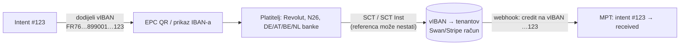

# Dio B — strana primatelja: tko javlja „uplata stigla“

Provjereno 2026-10-29. Oznake kao u [01](01-strana-platitelja.md).

**Skrbništvo:** u **Modu 1** novac ne smije stajati na računu MPT-a/ITalka. U **Modu 2** smije
stajati na **tenantovom** računu kod treće institucije. Svaki izvor ispod je promatrač nad
**tenantovim** računom. Nijedan ne smije postati račun na koji ITalk prima novac za druge.

## Sažetak

1. **Monerium ostaje jedini izvor koji uz dojavu i minta.** Svi ostali su čisti „listeneri“
   (ADR 0020 model): novac ostaje na tenantovom računu, a MPT samo uparuje intent.
2. **Virtualni IBAN po intentu** (Swan, Stripe bank transfer) rješava identitet **bez
   reference**. Uplata je prepoznata po IBAN-u na koji je stigla, pa joj ne trebaju ni opis
   ni iznos. To je jedini nađeni mehanizam otporan na Revolutovo ispuštanje reference, a ne
   krši pravilo „iznos ne nosi identitet“. Mana: IBAN-i su FR/DE/NL/BE/IT/ES, **nikad HR**, pa
   HR bankovne aplikacije s HUB3 ostaju vani (vidi 01 §2).
3. **HR IBAN s webhookom ne nudi nitko javno.** HR banke nemaju javni webhook za poslovne
   račune. Erste Group navodi „Corporate accounts API“ na grupnom portalu (REPORTED), ali za HR
   bez potvrde ⚠️. Za HR IBAN ostaju **bank-push-gateway** (sekunde) i **AIS** (sati).
4. Wise, Revolut Business i bunq imaju webhookove, ali na **vlastite** IBAN-e (BE, LT, NL/BE),
   bez virtualnih IBAN-a po uplati. Identitet i dalje ovisi o referenci. Ne donose ništa što
   Monerium već nema, osim izbjegavanja mint koraka za tenante koji ne žele EURe.

## Matrica B

| Izvor | Vrsta | Kašnjenje | Opis / platitelj u dojavi | IBAN | Tko drži novac | Trošak | KYB | Izvor |
|---|---|---|---|---|---|---|---|---|
| **Monerium** (danas) | webhook `order.*` | SCT Inst + mint ≤ 5–10 s; prva uplata s novog IBAN-a screening 1 min–8 h | memo, IBAN i ime platitelja | `EE…` (LHV), **na ime tenanta** | tenant (EURe na njegovom Safeu) | 0 na ulazu | tenant KYB kod Moneriuma | monerium.com/partners (VERIFIED); interno ADR 0017/0025, first-IBAN screening |
| **Wise Business** | webhook `balances#update` (profilna pretplata; `balances#credit` **deprecated**) | minute; instant ovisi o banci platitelja | `amount`, `currency`, `transfer_reference`; **ime platitelja nije u primjeru** ⚠️ | EUR: **BE** (Wise Europe SA) ili EE | tenant (Wise račun) | ⚠️ | Wise KYB tenanta | docs.wise.com essential-webhooks, eventbalancescredit (VERIFIED); wise.com/help SEPA (REPORTED) |
| **Revolut Business** | webhook v2 `TransactionCreated`, `TransactionStateChanged`; potpis `Revolut-Signature`; 3 ponovna pokušaja / 10 min | sekunde ⚠️ | `reference`; counterparty `account_type` ⚠️ za vanjske | `LT…` | tenant | plan ⚠️ | Revolut KYB | developer.revolut.com webhooks v2 (VERIFIED) |
| **bunq** (Business) | callback (notification filter URL, kategorija `PAYMENT`) | sekunde ⚠️ | `description`, iznos | NL/BE/DE/FR (od 2026 i **BE za strane klijente**) | tenant | plan ⚠️ | bunq KYB | doc.bunq.com callbacks (VERIFIED); dutchitchannel 27.7.2026 |
| **Swan** (BaaS, FR EMI) | webhookovi ⚠️ (imena eventova nismo potvrdili) | SCT Inst ⚠️ | **virtualni IBAN = identitet** | FR/DE/ES/NL/IT/BE; **neograničeno virtualnih IBAN-a** po računu | tenantov Swan račun (ako ga MPT otvara kao partner: **provjeriti skrbništvo**) | ⚠️ | Swan KYB tenanta; neverificirani: ulaz >50 € odbijen, saldo ≤150 € | docs.swan.io ibans, changelog 29.1.2026 (VERIFIED) |
| **Stripe** bank transfer (`customer_balance`, `eu_bank_transfer`) | webhook `payment_intent.*` / `cash_balance` | SCT ⚠️ | virtualni IBAN po kupcu | DE/FR/IE/NL/(BE); **ES ukinut** | tenantov Stripe saldo → payout | ⚠️ | Stripe KYB tenanta | docs.stripe.com bank-transfers, spanish-virtual-account-discontinuation (VERIFIED) |
| Mollie / Adyen bank transfer | ⚠️ nije istraženo detaljno | | | | tenant (merchant) | | | — |
| **AIS** (Enable Banking; GoCardless zatvoren za nove) | polling | ~4×/dan → sati | puni izvod: ime, IBAN, opis | **HR** ✅ (Zaba, PBZ, Erste, RBA; OTP ❌) | tenant (HR banka) | ⚠️ | — | ADR 0020; enablebanking HR (VERIFIED) |
| **bank-push-gateway** | push obavijest banke → potpisani webhook `account.credit` | sekunde | ovisi o banci (poziv na broj ⚠️ po banci) | **HR** ✅ | tenant | namjenski telefon | — | ADR 0020; faza 0 PBZ, HPB |
| HR banke, vlastiti API | ❌ javno ne postoji | — | — | HR | — | — | — | ADR 0020; Erste Group portal (REPORTED) |

## Što virtualni IBAN po intentu mijenja

- Identitet nosi **odredište**, ne opis ni iznos. Revolutovo ispuštanje reference postaje
  nevažno.
- Cijena: drugi pružatelj, KYB tenanta kod njega i nema EURe minta. Ako tenant želi EURe, treba
  zasebni sweep na Monerium IBAN, a to je novi korak i novi rizik.
- HR platitelji s HUB3 ne profitiraju (strani IBAN). Mogu tipkati IBAN, isto kao danas.
- **Skrbništvo:** ako MPT preko Swana otvara račune **u ime tenanta** (tenant je vlasnik
  računa i prolazi Swanov KYB), novac je tenantov. Ako bi vIBAN-i visjeli na **ITalkovom**
  Swan računu, to je pooling i skrbništvo → **zabranjeno u Modu 1**.

## Izvori (provjereno 2026-10-29)

- Wise: https://docs.wise.com/guides/developer/webhooks/essential-webhooks.md ; https://docs.wise.com/api-reference/webhook-event/eventbalancescredit ; https://www.wise.com/help/articles/2956754/what-are-sepa-transfers
- Revolut Business webhooks v2: https://developer.revolut.com/docs/guides/manage-accounts/webhooks/about-webhooks
- bunq: https://doc.bunq.com/basics/callbacks-webhooks ; https://doc.bunq.com/notification-filter ; https://www.dutchitchannel.nl/news/756366/bunq-biedt-belgische-ibans-aan-voor-internationale-klanten
- Swan: https://docs.swan.io/topics/accounts/ibans ; https://docs.swan.io/changelog/29-january-2026
- Stripe: https://docs.stripe.com/payments/bank-transfers ; https://docs.stripe.com/payments/customer-balance/virtual-bank-account-numbers/spanish-virtual-account-discontinuation
- Monerium: https://monerium.com/partners/
- Enable Banking HR: https://enablebanking.com/docs/markets/hr/
- Erste Group API katalog: https://openbankingtracker.com/provider/erste-group/apis
- Interno: ADR 0016, 0017, 0018, 0020, 0025, 0028; `docs/research/2026-09-monerium-first-iban-screening.md`
