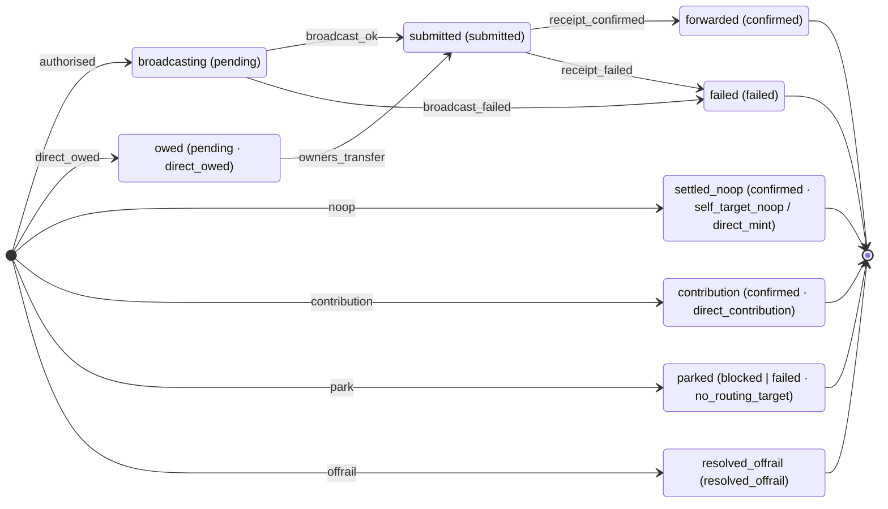
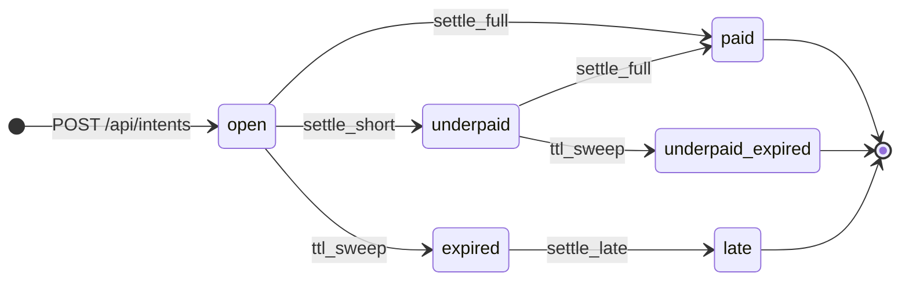

# State machine MPT raila: forward i intent

Svaka uplata prolazi kroz dva state machinea:

- **Forward** (`monerium_forwards`, jedan red po pokušaju za jedan Monerium order) kaže što se
  dogodilo s novcem.
- **Intent** (`payment_intents`) kaže što darovatelj i merchant vide.

Izvor istine je kod:
[`backend/src/monerium/forwardStates.ts`](../backend/src/monerium/forwardStates.ts) i
[`backend/src/intents/intentStates.ts`](../backend/src/intents/intentStates.ts). Dijagrami niže
**generiraju se iz tih tablica**. `test/stateMachines.test.ts` pada ako dokument nije jednak
generiranom. Osvježavanje:

```bash
cd backend && UPDATE_STATE_DOCS=1 npx vitest run test/stateMachines.test.ts
```

Isti test za **svaki par (stanje, događaj)** izvrši pravi SQL nad migriranom bazom. Provjerava
da se prijelaz dogodi točno onda kad je u tablici, a nedopušteni prijelaz ne smije promijeniti
red.

## Forward

<!-- generated:forward -->

<!-- /generated:forward -->

Pravila:

- Red se **rodi** u jednom stanju (`[*] --> …`) i prođe najviše dva brida.
- Jedina funkcija koja mijenja stanje postojećeg reda je `transitionForward`
  (`backend/src/monerium/db.ts`). Njezin `UPDATE` ima u `WHERE` logičko polazno stanje
  (`stateSql`), pa red ne može preskočiti brid ni vratiti se. `updateForward` je ostao samo za
  ishod broadcasta (`submitted` / `failed`) i baca grešku za sve ostalo.
- Završno stanje se ne oživljava. Retry, reroute i `resolved_offrail` **upisuju novi red** za isti
  order. Zasun `ux_forwards_live` (migracija 0016) to dopušta samo kad order nema živog reda.

| Stanje | DB `status` · `error` | Tko ga stvara / pomiče |
|---|---|---|
| `broadcasting` | `pending` | gate `forward` → `handleForward` šalje tx |
| `owed` | `pending` · `direct_owed` | gate `direct_owed` (D4) → detektor odljeva vidi 2/3 prijenos |
| `submitted` | `submitted` | potvrdu čitaju poll, cron reconcile i read path (jedan pobjednik) |
| `forwarded` | `confirmed` | intent `settle_full` / `settle_short` / `settle_late` |
| `settled_noop` | `confirmed` · `self_target_noop` / `direct_mint` | mint je već na odredištu |
| `contribution` | `confirmed` · `direct_contribution` | direct D6, doprinos kampanji |
| `parked` | `blocked` (ili `failed` · `no_routing_target`, povijesno) | gate `park`, alarm |
| `failed` | `failed` | broadcast greška, revert, ispao iz mempoola → admin retry |
| `resolved_offrail` | `resolved_offrail` | operater, prijenos provjeren on-chain |

Nastavci na razini ordera (novi red): `failed` → admin retry; `parked` → admin reroute (u načinu
direct završava kao `owed`); `parked`/`failed` → `resolved_offrail`.

## Intent

<!-- generated:intent -->

<!-- /generated:intent -->

`payment_intents.state` ima tri vrijednosti (`pending`, `paid`, `expired`). Zajedno s
`monerium_order_id` i `paid_at` one čine šest logičkih stanja (`logicalIntentState`). Svaki upis
u `backend/src/intents/db.ts` je uvjetni `UPDATE` čiji je `WHERE` polazno stanje jednog brida.

| Stanje | DB | Značenje |
|---|---|---|
| `open` | `pending`, bez ordera | čeka uplatu |
| `underpaid` | `pending`, s orderom | stiglo manje od traženog (BW-01); merchant dobiva `payment.underpaid` |
| `paid` | `paid` | plaćeno u cijelosti |
| `expired` | `expired`, bez ordera | isteklo bez uplate (cron) |
| `late` | `expired`, s orderom i `paid_at` | stiglo nakon isteka; `payment.late` |
| `underpaid_expired` | `expired`, s orderom, bez `paid_at` | manje od traženog, pa isteklo |

Faza na checkoutu (`awaiting_payment` → … → `settled`) **nije spremljeno stanje**:
`computeStage` (`backend/src/intents/stage.ts`) je izračuna iz intenta, ordera i forwarda.

## Koji događaj gate daje za koju uplatu

Gate (`authorizeForward`, `backend/src/tenants/whitelist.ts`) odlučuje kako se forward rodi.

| # | Opis plaćanja | Gdje Monerium minta | Gate → forward | Komentar |
|---|---|---|---|---|
| F1 | `mpt:0x<T>?sid=<sid>` | glavni Safe | `forward` → `broadcasting` | glavni put u načinu forward |
| F2 | `mpt:` s adresom ≠ cilju intenta | glavni Safe | `park` `target_mismatch` | zaštita od podmetnute adrese |
| F3 | `mpt:` bez sida / s nepoznatim sidom | glavni Safe | `park` `missing_sid` / `unknown_sid` | |
| F4 | `mpt:` gdje je cilj glavni Safe | glavni Safe | `self_noop` → `settled_noop` | uplata „u Safe" |
| F5 | `cmp:0x<C>?id=<kampanja>` | glavni Safe | `forward` → `broadcasting` | trajni QR, doprinos kampanji |
| F6 | `cmp:` s nepoznatom kampanjom ili krivom adresom | glavni Safe | `park` | |
| F7 | `gnosis:0x<X> …`, X povezan | X | `park` `mint_address_mismatch` | novac je na X, intent se ne zatvara |
| F8 | `gnosis:` nepovezan, bez razmaka, goli `0x`, tekst ispred | glavni Safe | `park` `unroutable_prefix` | slobodan tekst ne bira odredište (ADR 0016) |
| F9 | prazan opis / slobodan tekst / HUB3 | glavni Safe | stray resolver: pogodak → `forward`; nesiguran → `park` | iznos + vrijeme, 48 h, samo pouzdani ciljevi |
| F11 | sid tuđeg tenanta | | `park` `tenant_mismatch` | |
| F12 | iznos ≥ kapice / cilj nije na whitelisti | | `park` `over_cap` / `not_whitelisted` | |
| D1 | `<chain>:0x<P> sid:<sid>` (direct) | P | `direct_settle` → `settled_noop` | izravni mint u Safe projekta |
| D4 | bez reference / sid bez razmaka (direct) | glavni Safe | resolver ili sid → `direct_owed` → `owed`; nesiguran → `park` | 2/3 prijenos zatvara intent |
| D5 | adresa u opisu ≠ cilju intenta (direct) | | `park` `target_mismatch` | |
| D6 | `<chain>:0x<Safe kampanje>` bez sida (direct) | Safe kampanje | `direct_contribution` → `contribution` | bez alarma |
| D2/3 | mint na adresu koja nije ni cilj ni glavni Safe (direct) | ta adresa | `park` `not_minted_to_target` | |

Prije gatea, za oba načina: neispravan potpis → 401; tuđi Monerium profil → ignorira se + alarm;
valuta nije EUR → `park` `unsupported_currency`. Usmjeravanje se pokreće tek na `order.updated` sa
stanjem `processed`.
